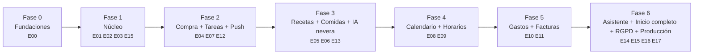
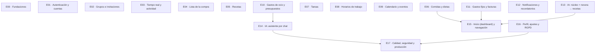
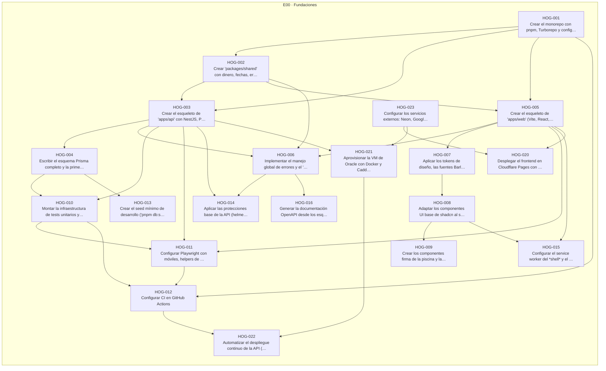
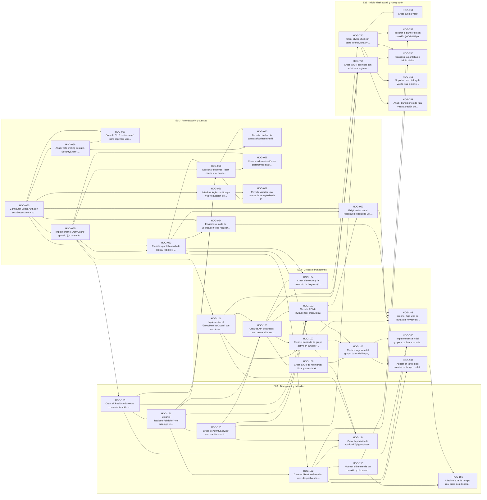
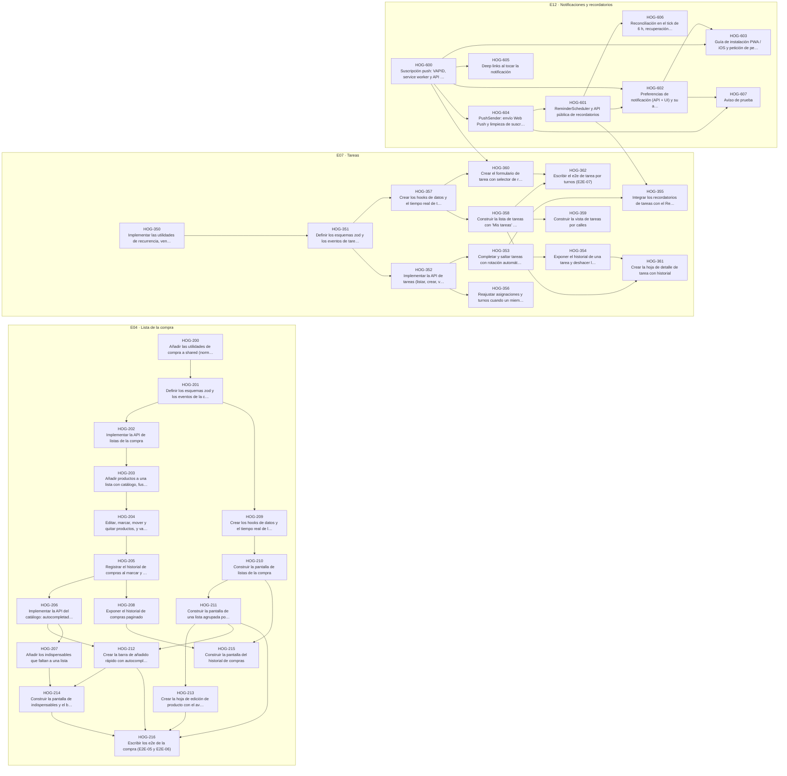
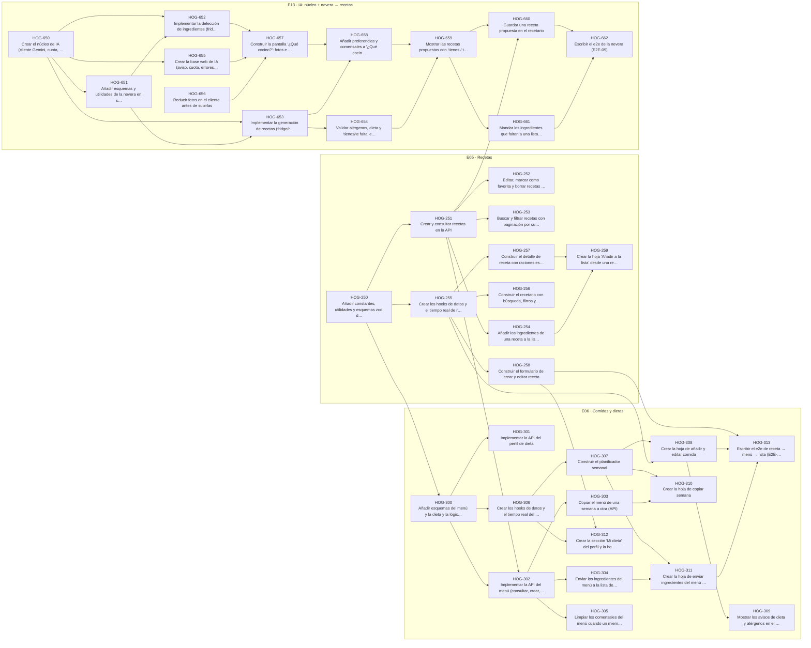
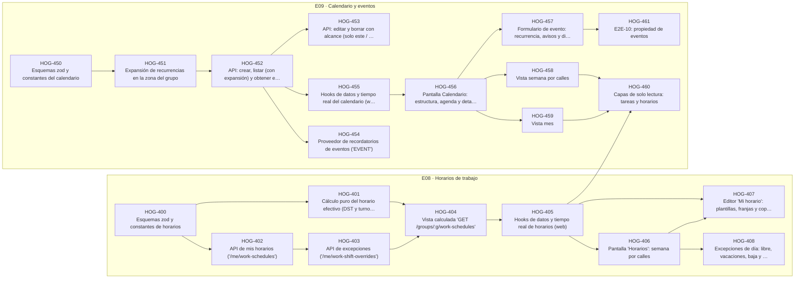
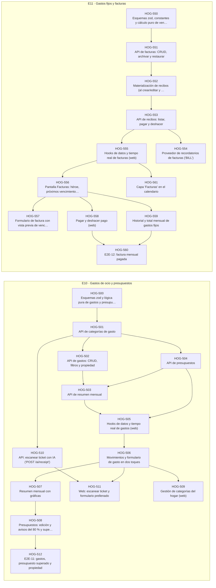
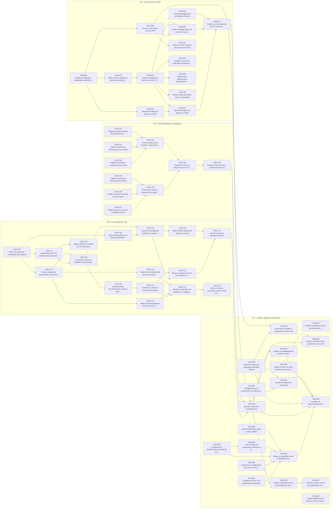

# BOARD — Hogaria

> **Única fuente de verdad del estado de los tickets.** Los archivos de `docs/tickets/` no llevan estado.
> Flujo (ver `AGENTS.md` §4): coge el **primer** ticket de *To Do* → muévelo a *In Progress* → al terminar, a *Done* → rellena *To Do* con los siguientes de *Backlog* cuyas dependencias estén todas en *Done* (respetando el orden de la tabla, que ya está ordenada topológicamente).
> Para mover un ticket, **corta su fila** de una sección y **pégala** en la otra. No cambies la columna "Depende de".

**Resumen:** 235 tickets · 703 puntos · 18 épicas · 7 fases
_Generado el 2026-11-11 a partir de docs/tickets/. Si añades tickets, añádelos a mano en Backlog en el sitio que respete sus dependencias._

## Leyenda
- **Prioridad:** P0 bloqueante de la fase · P1 necesario en la fase · P2 mejora · P3 opcional
- **Puntos:** 1 ≈ <1 h · 2 ≈ medio día · 3 ≈ 1 día · 5 ≈ 2–3 días · 8 ≈ dividir

---

## 🟡 In Progress
| ID | Título | Épica | Prio | Pts | Depende de |
|---|---|---|---|---|---|

## 🟦 To Do
| ID | Título | Épica | Prio | Pts | Depende de |
|---|---|---|---|---|---|
| HOG-023 | Configurar los servicios externos: Neon, Google OAuth y Resend | E00 | P1 | 2 | — |
| HOG-011 | Configurar Playwright con móviles, helpers de login y doble contexto | E00 | P0 | 3 | HOG-003, HOG-005, HOG-010 |

## ✅ Done
| ID | Título | Épica | Prio | Pts | Depende de |
|---|---|---|---|---|---|
| HOG-001 | Crear el monorepo con pnpm, Turborepo y configuración compartida | E00 | P0 | 3 | — |
| HOG-002 | Crear `packages/shared` con dinero, fechas, errores, constantes y tipos de tiempo real | E00 | P0 | 5 | HOG-001 |
| HOG-003 | Crear el esqueleto de `apps/api` con NestJS, Prisma, Postgres local y `/health` | E00 | P0 | 3 | HOG-001, HOG-002 |
| HOG-004 | Escribir el esquema Prisma completo y la primera migración | E00 | P0 | 3 | HOG-003 |
| HOG-005 | Crear el esqueleto de `apps/web` (Vite, React, Router, Query, Tailwind v4 y PWA) | E00 | P0 | 5 | HOG-001, HOG-002 |
| HOG-006 | Implementar el manejo global de errores y el `apiClient` web con `X-Client-Mutation-Id` | E00 | P0 | 3 | HOG-002, HOG-003, HOG-005 |
| HOG-007 | Aplicar los tokens de diseño, las fuentes Barlow autoalojadas y el tema claro/oscuro | E00 | P0 | 3 | HOG-005 |
| HOG-008 | Adaptar los componentes UI base de shadcn al sistema "Piscina municipal" | E00 | P0 | 5 | HOG-007 |
| HOG-009 | Crear los componentes firma de la piscina y la animación de onda | E00 | P0 | 5 | HOG-008 |
| HOG-010 | Montar la infraestructura de tests unitarios y de integración | E00 | P0 | 5 | HOG-003, HOG-004 |
| HOG-014 | Aplicar las protecciones base de la API (helmet, CORS, Origin y throttler) | E00 | P0 | 2 | HOG-003, HOG-006 |
| HOG-015 | Configurar el service worker del *shell* y el aviso de nueva versión | E00 | P1 | 2 | HOG-005, HOG-008 |
| HOG-013 | Crear el seed mínimo de desarrollo (`pnpm db:seed`) | E00 | P2 | 2 | HOG-004 |
| HOG-016 | Generar la documentación OpenAPI desde los esquemas zod (solo desarrollo) | E00 | P2 | 2 | HOG-006 |

---

## 📋 Backlog (ordenado por fase y dependencias)

### Fase 0 · Fundaciones — 20 tickets, 66 pts
| ID | Título | Épica | Prio | Pts | Depende de |
|---|---|---|---|---|---|
| HOG-012 | Configurar CI en GitHub Actions | E00 | P1 | 3 | HOG-001, HOG-010, HOG-011 |
| HOG-020 | Desplegar el frontend en Cloudflare Pages con DNS en Netlify y `_headers`/`_redirects` | E00 | P1 | 2 | HOG-005, HOG-023 |
| HOG-021 | Aprovisionar la VM de Oracle con Docker y Caddy y desplegar la API a mano | E00 | P1 | 5 | HOG-003, HOG-023 |
| HOG-022 | Automatizar el despliegue continuo de la API (GHCR + SSH) | E00 | P2 | 3 | HOG-012, HOG-021 |

### Fase 1 · Núcleo — 36 tickets, 120 pts
| ID | Título | Épica | Prio | Pts | Depende de |
|---|---|---|---|---|---|
| HOG-050 | Configurar Better Auth con email/username + contraseña, UUIDv7 y cookies entre subdominios | E01 | P0 | 5 | HOG-004, HOG-006, HOG-010 |
| HOG-055 | Implementar el `AuthGuard` global, `@CurrentUser`, `@Public` y `GET /me` | E01 | P0 | 3 | HOG-050, HOG-006 |
| HOG-053 | Crear las pantallas web de entrar, registro y recuperar contraseña | E01 | P0 | 5 | HOG-050, HOG-055, HOG-008 |
| HOG-054 | Enviar los emails de verificación y de recuperación de contraseña con Resend | E01 | P0 | 3 | HOG-050, HOG-053 |
| HOG-058 | Añadir rate limiting de auth, `SecurityEvent` y política de contraseñas | E01 | P0 | 5 | HOG-050, HOG-002 |
| HOG-057 | Crear la CLI `create-owner` para el primer usuario administrador | E01 | P0 | 2 | HOG-050, HOG-058 |
| HOG-101 | Implementar el `GroupMemberGuard` con caché de 60 s y 404 | E02 | P0 | 3 | HOG-055, HOG-004 |
| HOG-150 | Crear el `RealtimeGateway` con autenticación en el handshake y salas de usuario y grupo | E03 | P0 | 5 | HOG-055, HOG-014 |
| HOG-151 | Crear el `RealtimePublisher` y el catálogo tipado de eventos en `shared` | E03 | P0 | 3 | HOG-150, HOG-002, HOG-006 |
| HOG-152 | Crear el `RealtimeProvider` web: despacho a la caché de Query, deduplicación, onda y reconexión | E03 | P0 | 5 | HOG-151, HOG-005, HOG-006, HOG-009, HOG-053 |
| HOG-153 | Crear el `ActivityService` con escritura en transacción, *summaries* en español, `MaintenanceCron` y purga de retención | E03 | P0 | 3 | HOG-004, HOG-006, HOG-010, HOG-151 |
| HOG-100 | Crear la API de grupos: crear con semilla, ver, editar y `/me/groups` | E02 | P0 | 5 | HOG-101, HOG-151, HOG-153 |
| HOG-102 | Crear la API de invitaciones: crear, listar, revocar, consultar pública y aceptar | E02 | P0 | 5 | HOG-100, HOG-150, HOG-151, HOG-153 |
| HOG-052 | Exigir invitación al registrarse (hooks de Better Auth y cookie `hogaria_invite`) | E01 | P0 | 3 | HOG-050, HOG-053, HOG-102 |
| HOG-104 | Crear el selector y la creación de hogares (`/grupos`) y la redirección de entrada | E02 | P0 | 3 | HOG-100, HOG-053, HOG-008, HOG-009 |
| HOG-107 | Crear el contexto de grupo activo en la web (`GroupLayout`) y la pantalla "No encontrado" | E02 | P0 | 3 | HOG-100, HOG-101, HOG-053, HOG-008 |
| HOG-103 | Crear el flujo web de invitación `/invite/:token` | E02 | P0 | 3 | HOG-102, HOG-052, HOG-054, HOG-107 |
| HOG-108 | Crear la API de miembros: listar y cambiar el color de calle propio | E02 | P0 | 2 | HOG-100 |
| HOG-105 | Crear los ajustes del grupo: datos del hogar, miembros, color de calle e invitaciones | E02 | P0 | 5 | HOG-102, HOG-107, HOG-108, HOG-009 |
| HOG-106 | Implementar salir del grupo, expulsar a un miembro y borrar el grupo al salir el último | E02 | P0 | 5 | HOG-105, HOG-150, HOG-152 |
| HOG-155 | Mostrar el banner de sin conexión y bloquear la edición | E03 | P0 | 3 | HOG-152, HOG-008, HOG-009 |
| HOG-750 | Crear el AppShell con barra inferior, rutas y selector de hogar | E15 | P0 | 5 | HOG-005, HOG-007, HOG-008, HOG-009, HOG-104 |
| HOG-751 | Crear la hoja "Más" | E15 | P0 | 2 | HOG-750 |
| HOG-752 | Integrar el banner de sin conexión (HOG-155) en el AppShell | E15 | P0 | 1 | HOG-155, HOG-750 |
| HOG-754 | Crear la API del Inicio con secciones registrables | E15 | P0 | 3 | HOG-100, HOG-101, HOG-153 |
| HOG-755 | Construir la pantalla de Inicio básica | E15 | P0 | 3 | HOG-750, HOG-754, HOG-152 |
| HOG-051 | Añadir el login con Google y la vinculación de cuentas por email | E01 | P1 | 2 | HOG-050, HOG-023 |
| HOG-056 | Gestionar sesiones: listar, cerrar una, cerrar las demás y cerrar sesión, con `session.revoked` | E01 | P1 | 5 | HOG-053, HOG-055, HOG-150, HOG-151 |
| HOG-060 | Permitir cambiar la contraseña desde Perfil → Seguridad | E01 | P1 | 2 | HOG-056, HOG-058 |
| HOG-109 | Aplicar en la web los eventos en tiempo real de grupos, miembros e invitaciones | E02 | P1 | 2 | HOG-152, HOG-105 |
| HOG-154 | Crear la pantalla de actividad `/g/:groupId/actividad` y su evento `activity.created` | E03 | P1 | 3 | HOG-153, HOG-152, HOG-107, HOG-101 |
| HOG-156 | Añadir el e2e de tiempo real entre dos dispositivos y sin conexión | E03 | P1 | 2 | HOG-011, HOG-109, HOG-155 |
| HOG-756 | Soportar deep links y la vuelta tras iniciar sesión | E15 | P1 | 2 | HOG-750 |
| HOG-059 | Crear la administración de plataforma: listar, bloquear y desbloquear usuarios | E01 | P2 | 5 | HOG-055, HOG-056, HOG-008 |
| HOG-061 | Permitir vincular una cuenta de Google desde Perfil → Seguridad | E01 | P2 | 2 | HOG-051, HOG-056 |
| HOG-753 | Añadir transiciones de ruta y restauración del scroll | E15 | P2 | 2 | HOG-750 |

### Fase 2 · Compra + Tareas + Push — 38 tickets, 124 pts
| ID | Título | Épica | Prio | Pts | Depende de |
|---|---|---|---|---|---|
| HOG-200 | Añadir las utilidades de compra a shared (normalización, unidades, cantidades y añadido rápido) | E04 | P0 | 3 | HOG-002 |
| HOG-201 | Definir los esquemas zod y los eventos de la compra en shared | E04 | P0 | 2 | HOG-200 |
| HOG-202 | Implementar la API de listas de la compra | E04 | P0 | 3 | HOG-201, HOG-004, HOG-101, HOG-151, HOG-153 |
| HOG-203 | Añadir productos a una lista con catálogo, fusión de duplicados y alta en bloque | E04 | P0 | 5 | HOG-202 |
| HOG-204 | Editar, marcar, mover y quitar productos, y vaciar comprados | E04 | P0 | 5 | HOG-203 |
| HOG-209 | Crear los hooks de datos y el tiempo real de la compra en la web | E04 | P0 | 5 | HOG-201, HOG-006, HOG-152 |
| HOG-210 | Construir la pantalla de listas de la compra | E04 | P0 | 3 | HOG-209, HOG-750, HOG-008, HOG-009 |
| HOG-211 | Construir la pantalla de una lista agrupada por pasillos con marcar de un toque | E04 | P0 | 5 | HOG-210 |
| HOG-213 | Crear la hoja de edición de producto con el aviso de conflicto | E04 | P0 | 3 | HOG-211 |
| HOG-350 | Implementar las utilidades de recurrencia, vencimiento y rotación en shared | E07 | P0 | 5 | HOG-002 |
| HOG-351 | Definir los esquemas zod y los eventos de tareas en shared | E07 | P0 | 2 | HOG-350 |
| HOG-352 | Implementar la API de tareas (listar, crear, ver, editar y borrar) | E07 | P0 | 5 | HOG-351, HOG-004, HOG-101, HOG-151, HOG-153 |
| HOG-353 | Completar y saltar tareas con rotación automática | E07 | P0 | 5 | HOG-352 |
| HOG-357 | Crear los hooks de datos y el tiempo real de tareas en la web | E07 | P0 | 3 | HOG-351, HOG-006, HOG-152 |
| HOG-358 | Construir la lista de tareas con "Mis tareas" y "Todas", agrupada y con completar de un toque | E07 | P0 | 5 | HOG-357, HOG-750, HOG-009 |
| HOG-600 | Suscripción push: VAPID, service worker y API de suscripciones | E12 | P0 | 5 | HOG-002, HOG-003, HOG-004, HOG-005, HOG-015, HOG-055 |
| HOG-360 | Crear el formulario de tarea con selector de repetición y turnos | E07 | P0 | 5 | HOG-357, HOG-008, HOG-600 |
| HOG-362 | Escribir el e2e de tarea por turnos (E2E-07) | E07 | P0 | 2 | HOG-358, HOG-360, HOG-011 |
| HOG-604 | PushSender: envío Web Push y limpieza de suscripciones muertas | E12 | P0 | 2 | HOG-600 |
| HOG-601 | ReminderScheduler y API pública de recordatorios | E12 | P0 | 5 | HOG-004, HOG-106, HOG-153, HOG-604 |
| HOG-606 | Reconciliación en el tick de 6 h, recuperación al arrancar y limpieza | E12 | P0 | 3 | HOG-601 |
| HOG-205 | Registrar el historial de compras al marcar y deshacerlo al desmarcar | E04 | P1 | 3 | HOG-204 |
| HOG-206 | Implementar la API del catálogo: autocompletado, frecuentes, indispensables y edición | E04 | P0 | 3 | HOG-205 |
| HOG-212 | Crear la barra de añadido rápido con autocompletado y "Sueles comprar" | E04 | P0 | 3 | HOG-211, HOG-206 |
| HOG-207 | Añadir los indispensables que faltan a una lista | E04 | P1 | 2 | HOG-206 |
| HOG-214 | Construir la pantalla de indispensables y el botón "Añadir indispensables que faltan" | E04 | P1 | 3 | HOG-212, HOG-207 |
| HOG-216 | Escribir los e2e de la compra (E2E-05 y E2E-06) | E04 | P0 | 3 | HOG-211, HOG-212, HOG-213, HOG-214, HOG-011 |
| HOG-354 | Exponer el historial de una tarea y deshacer la última completación | E07 | P1 | 3 | HOG-353 |
| HOG-355 | Integrar los recordatorios de tareas con el ReminderScheduler | E07 | P1 | 3 | HOG-353, HOG-601 |
| HOG-356 | Reajustar asignaciones y turnos cuando un miembro sale del hogar | E07 | P1 | 2 | HOG-352, HOG-106 |
| HOG-359 | Construir la vista de tareas por calles | E07 | P1 | 3 | HOG-358 |
| HOG-361 | Crear la hoja de detalle de tarea con historial | E07 | P1 | 3 | HOG-358, HOG-354, HOG-756 |
| HOG-602 | Preferencias de notificación (API + UI) y su aplicación al disparar | E12 | P1 | 3 | HOG-601, HOG-600, HOG-750, HOG-008 |
| HOG-603 | Guía de instalación PWA / iOS y petición de permiso en contexto | E12 | P1 | 3 | HOG-600, HOG-602, HOG-750 |
| HOG-605 | Deep links al tocar la notificación | E12 | P1 | 2 | HOG-600, HOG-750 |
| HOG-208 | Exponer el historial de compras paginado | E04 | P2 | 1 | HOG-205 |
| HOG-215 | Construir la pantalla del historial de compras | E04 | P2 | 2 | HOG-208, HOG-210 |
| HOG-607 | Aviso de prueba | E12 | P2 | 1 | HOG-604, HOG-602 |

### Fase 3 · Recetas + Comidas + IA nevera — 37 tickets, 110 pts
| ID | Título | Épica | Prio | Pts | Depende de |
|---|---|---|---|---|---|
| HOG-250 | Añadir constantes, utilidades y esquemas zod de recetas a shared | E05 | P0 | 3 | HOG-200 |
| HOG-251 | Crear y consultar recetas en la API | E05 | P0 | 3 | HOG-250, HOG-004, HOG-101, HOG-151, HOG-153 |
| HOG-252 | Editar, marcar como favorita y borrar recetas en la API | E05 | P0 | 3 | HOG-251 |
| HOG-253 | Buscar y filtrar recetas con paginación por cursor | E05 | P0 | 3 | HOG-251 |
| HOG-254 | Añadir los ingredientes de una receta a la lista de la compra (API) | E05 | P0 | 2 | HOG-251, HOG-203 |
| HOG-255 | Crear los hooks de datos y el tiempo real de recetas en la web | E05 | P0 | 3 | HOG-250, HOG-006, HOG-152 |
| HOG-256 | Construir el recetario con búsqueda, filtros y favoritas | E05 | P0 | 5 | HOG-255, HOG-750, HOG-008, HOG-009 |
| HOG-257 | Construir el detalle de receta con raciones escalables | E05 | P0 | 3 | HOG-255, HOG-009 |
| HOG-258 | Construir el formulario de crear y editar receta | E05 | P0 | 5 | HOG-255 |
| HOG-300 | Añadir esquemas del menú y la dieta y la lógica de avisos y agregación a shared | E06 | P0 | 3 | HOG-250 |
| HOG-301 | Implementar la API del perfil de dieta | E06 | P0 | 3 | HOG-300, HOG-004, HOG-055, HOG-101, HOG-151 |
| HOG-302 | Implementar la API del menú (consultar, crear, editar y quitar comidas) | E06 | P0 | 5 | HOG-300, HOG-251, HOG-101, HOG-151, HOG-153 |
| HOG-304 | Enviar los ingredientes del menú a la lista de la compra (API) | E06 | P0 | 3 | HOG-302, HOG-203 |
| HOG-306 | Crear los hooks de datos y el tiempo real del menú y la dieta en la web | E06 | P0 | 3 | HOG-300, HOG-006, HOG-152 |
| HOG-307 | Construir el planificador semanal | E06 | P0 | 5 | HOG-306, HOG-750, HOG-009 |
| HOG-308 | Crear la hoja de añadir y editar comida | E06 | P0 | 3 | HOG-307, HOG-255 |
| HOG-311 | Crear la hoja de enviar ingredientes del menú a la lista | E06 | P0 | 3 | HOG-307, HOG-304, HOG-209 |
| HOG-312 | Crear la sección "Mi dieta" del perfil y la hoja "Dietas del hogar" | E06 | P0 | 3 | HOG-306, HOG-258, HOG-750 |
| HOG-313 | Escribir el e2e de receta → menú → lista (E2E-08) | E06 | P0 | 3 | HOG-258, HOG-308, HOG-311, HOG-011 |
| HOG-650 | Crear el núcleo de IA (cliente Gemini, cuota, aviso e imágenes) | E13 | P0 | 5 | HOG-003, HOG-004, HOG-006, HOG-010, HOG-055, HOG-101, HOG-151 |
| HOG-651 | Añadir esquemas y utilidades de la nevera en shared | E13 | P0 | 2 | HOG-002, HOG-650 |
| HOG-652 | Implementar la detección de ingredientes (fridge/detect) | E13 | P0 | 3 | HOG-650, HOG-651 |
| HOG-653 | Implementar la generación de recetas (fridge/recipes) con restricciones de dieta | E13 | P0 | 3 | HOG-650, HOG-651 |
| HOG-654 | Validar alérgenos, dieta y "tienes/te falta" en el servidor | E13 | P0 | 2 | HOG-653 |
| HOG-655 | Crear la base web de IA (aviso, cuota, errores y tiempo real) | E13 | P0 | 3 | HOG-650, HOG-008, HOG-009, HOG-152, HOG-750 |
| HOG-656 | Reducir fotos en el cliente antes de subirlas | E13 | P0 | 2 | HOG-005 |
| HOG-657 | Construir la pantalla "¿Qué cocino?": fotos e ingredientes | E13 | P0 | 3 | HOG-652, HOG-655, HOG-656 |
| HOG-658 | Añadir preferencias y comensales a "¿Qué cocino?" | E13 | P0 | 3 | HOG-657, HOG-653 |
| HOG-659 | Mostrar las recetas propuestas con "tienes / te falta" y avisos | E13 | P0 | 3 | HOG-658, HOG-654 |
| HOG-660 | Guardar una receta propuesta en el recetario | E13 | P0 | 2 | HOG-659, HOG-251 |
| HOG-661 | Mandar los ingredientes que faltan a una lista de la compra | E13 | P0 | 2 | HOG-659, HOG-203 |
| HOG-259 | Crear la hoja "Añadir a la lista" desde una receta | E05 | P1 | 2 | HOG-257, HOG-254, HOG-209 |
| HOG-303 | Copiar el menú de una semana a otra (API) | E06 | P1 | 3 | HOG-302 |
| HOG-305 | Limpiar los comensales del menú cuando un miembro sale del hogar | E06 | P1 | 1 | HOG-302, HOG-106 |
| HOG-309 | Mostrar los avisos de dieta y alérgenos en el menú | E06 | P1 | 2 | HOG-308 |
| HOG-310 | Crear la hoja de copiar semana | E06 | P1 | 2 | HOG-307, HOG-303 |
| HOG-662 | Escribir el e2e de la nevera (E2E-09) | E13 | P1 | 3 | HOG-660, HOG-661, HOG-011 |

### Fase 4 · Calendario + Horarios — 21 tickets, 62 pts
| ID | Título | Épica | Prio | Pts | Depende de |
|---|---|---|---|---|---|
| HOG-400 | Esquemas zod y constantes de horarios | E08 | P0 | 2 | HOG-002 |
| HOG-401 | Cálculo puro del horario efectivo (DST y turnos nocturnos) | E08 | P0 | 3 | HOG-400 |
| HOG-402 | API de mis horarios (`/me/work-schedules`) | E08 | P0 | 3 | HOG-400, HOG-003, HOG-004, HOG-055, HOG-151, HOG-153 |
| HOG-403 | API de excepciones (`/me/work-shift-overrides`) | E08 | P0 | 3 | HOG-402 |
| HOG-404 | Vista calculada `GET /groups/:g/work-schedules` | E08 | P0 | 2 | HOG-401, HOG-403, HOG-101 |
| HOG-405 | Hooks de datos y tiempo real de horarios (web) | E08 | P0 | 2 | HOG-404, HOG-006, HOG-152 |
| HOG-406 | Pantalla "Horarios": semana por calles | E08 | P0 | 5 | HOG-405, HOG-009, HOG-750 |
| HOG-407 | Editor "Mi horario": plantillas, franjas y copiar día | E08 | P0 | 5 | HOG-405, HOG-008, HOG-406 |
| HOG-450 | Esquemas zod y constantes del calendario | E09 | P0 | 2 | HOG-002 |
| HOG-451 | Expansión de recurrencias en la zona del grupo | E09 | P0 | 3 | HOG-450 |
| HOG-452 | API: crear, listar (con expansión) y obtener eventos | E09 | P0 | 3 | HOG-451, HOG-003, HOG-004, HOG-101, HOG-151, HOG-153 |
| HOG-453 | API: editar y borrar con alcance (solo este / toda la serie) y propiedad | E09 | P0 | 3 | HOG-452, HOG-106 |
| HOG-455 | Hooks de datos y tiempo real del calendario (web) | E09 | P0 | 2 | HOG-452, HOG-006, HOG-152 |
| HOG-456 | Pantalla Calendario: estructura, agenda y detalle | E09 | P0 | 3 | HOG-455, HOG-009, HOG-750, HOG-756 |
| HOG-457 | Formulario de evento: recurrencia, avisos y diálogo de alcance | E09 | P0 | 5 | HOG-456, HOG-603 |
| HOG-408 | Excepciones de día: libre, vacaciones, baja y horario especial | E08 | P1 | 3 | HOG-406 |
| HOG-454 | Proveedor de recordatorios de eventos (`EVENT`) | E09 | P1 | 2 | HOG-601, HOG-452 |
| HOG-458 | Vista semana por calles | E09 | P1 | 3 | HOG-456 |
| HOG-459 | Vista mes | E09 | P1 | 3 | HOG-456 |
| HOG-461 | E2E-10: propiedad de eventos | E09 | P1 | 2 | HOG-457, HOG-011 |
| HOG-460 | Capas de solo lectura: tareas y horarios | E09 | P2 | 3 | HOG-458, HOG-459, HOG-405, HOG-352 |

### Fase 5 · Gastos + Facturas — 25 tickets, 70 pts
| ID | Título | Épica | Prio | Pts | Depende de |
|---|---|---|---|---|---|
| HOG-500 | Esquemas zod y lógica pura de gastos y presupuestos | E10 | P0 | 2 | HOG-002 |
| HOG-501 | API de categorías de gasto | E10 | P0 | 2 | HOG-500, HOG-100, HOG-101, HOG-151, HOG-153 |
| HOG-502 | API de gastos: CRUD, filtros y propiedad | E10 | P0 | 3 | HOG-501, HOG-106 |
| HOG-504 | API de presupuestos | E10 | P0 | 2 | HOG-501, HOG-106 |
| HOG-503 | API de resumen mensual | E10 | P0 | 3 | HOG-502, HOG-504 |
| HOG-505 | Hooks de datos y tiempo real de gastos (web) | E10 | P0 | 2 | HOG-503, HOG-504, HOG-006, HOG-152 |
| HOG-506 | Movimientos y formulario de gasto en dos toques | E10 | P0 | 5 | HOG-505, HOG-009, HOG-750 |
| HOG-550 | Esquemas zod, constantes y cálculo puro de vencimientos | E11 | P0 | 3 | HOG-002 |
| HOG-551 | API de facturas: CRUD, archivar y restaurar | E11 | P0 | 3 | HOG-550, HOG-003, HOG-004, HOG-101, HOG-106, HOG-151, HOG-153 |
| HOG-552 | Materialización de recibos (al crear/editar y en el tick de 6 h) | E11 | P0 | 3 | HOG-551, HOG-153 |
| HOG-553 | API de recibos: listar, pagar y deshacer | E11 | P0 | 3 | HOG-552 |
| HOG-555 | Hooks de datos y tiempo real de facturas (web) | E11 | P0 | 2 | HOG-553, HOG-006, HOG-152 |
| HOG-556 | Pantalla Facturas: héroe, próximos vencimientos y lista | E11 | P0 | 5 | HOG-555, HOG-009, HOG-750, HOG-756 |
| HOG-557 | Formulario de factura con vista previa de vencimientos | E11 | P0 | 3 | HOG-556, HOG-603 |
| HOG-558 | Pagar y deshacer pago (web) | E11 | P0 | 2 | HOG-556 |
| HOG-507 | Resumen mensual con gráficas | E10 | P1 | 5 | HOG-506 |
| HOG-508 | Presupuestos: edición y avisos del 80 % y superado | E10 | P1 | 3 | HOG-507 |
| HOG-510 | API: escanear ticket con IA (`POST /ai/receipt`) | E10 | P1 | 3 | HOG-650, HOG-501 |
| HOG-511 | Web: escanear ticket y formulario prellenado | E10 | P1 | 3 | HOG-510, HOG-506 |
| HOG-512 | E2E-11: gastos, presupuesto superado y propiedad | E10 | P1 | 2 | HOG-508, HOG-011 |
| HOG-554 | Proveedor de recordatorios de facturas (`BILL`) | E11 | P1 | 2 | HOG-601, HOG-553 |
| HOG-559 | Historial y total mensual de gastos fijos | E11 | P1 | 3 | HOG-556 |
| HOG-560 | E2E-12: factura mensual pagada | E11 | P1 | 2 | HOG-558, HOG-559, HOG-011 |
| HOG-509 | Gestión de categorías del hogar (web) | E10 | P2 | 2 | HOG-506 |
| HOG-561 | Capa "Facturas" en el calendario | E11 | P2 | 2 | HOG-460, HOG-555 |

### Fase 6 · Asistente + Inicio completo + RGPD + Producción — 58 tickets, 151 pts
| ID | Título | Épica | Prio | Pts | Depende de |
|---|---|---|---|---|---|
| HOG-700 | Definir los esquemas compartidos del asistente | E14 | P0 | 2 | HOG-002, HOG-650 |
| HOG-701 | Implementar la API de conversaciones del asistente | E14 | P0 | 3 | HOG-700, HOG-101 |
| HOG-702 | Crear el registro de herramientas y las de lectura de compra, recetas y menú | E14 | P0 | 5 | HOG-700, HOG-251, HOG-203, HOG-302 |
| HOG-703 | Añadir las herramientas de lectura de tareas, calendario y horarios | E14 | P0 | 3 | HOG-702, HOG-352, HOG-404, HOG-452 |
| HOG-705 | Orquestar el turno del asistente con streaming SSE | E14 | P0 | 5 | HOG-701, HOG-702 |
| HOG-706 | Implementar las herramientas de escritura como propuestas (pendingAction) | E14 | P0 | 3 | HOG-705, HOG-351, HOG-450 |
| HOG-707 | Confirmar y descartar acciones propuestas | E14 | P0 | 3 | HOG-706 |
| HOG-709 | Crear el cliente SSE y los hooks del asistente en la web | E14 | P0 | 3 | HOG-700, HOG-006 |
| HOG-710 | Construir la pantalla del asistente con streaming e historial | E14 | P0 | 5 | HOG-709, HOG-705, HOG-655, HOG-750 |
| HOG-711 | Mostrar la tarjeta de acción con confirmar y descartar | E14 | P0 | 2 | HOG-710, HOG-707 |
| HOG-800 | Ampliar los esquemas compartidos de perfil, exportación y borrado | E16 | P0 | 2 | HOG-002 |
| HOG-801 | Editar nombre, nombre de usuario y foto desde la API | E16 | P0 | 3 | HOG-800, HOG-004, HOG-055, HOG-151 |
| HOG-802 | Construir la página de perfil y la sección "Tu cuenta" | E16 | P0 | 3 | HOG-801, HOG-750 |
| HOG-806 | Exportar los datos del usuario en JSON | E16 | P0 | 5 | HOG-800, HOG-055 |
| HOG-807 | Añadir "Descargar mis datos" en el perfil | E16 | P0 | 1 | HOG-806, HOG-802 |
| HOG-808 | Borrar la cuenta del usuario (API) | E16 | P0 | 5 | HOG-800, HOG-106, HOG-150, HOG-151, HOG-601 |
| HOG-809 | Añadir el diálogo "Borrar mi cuenta" en el perfil | E16 | P0 | 2 | HOG-808, HOG-802 |
| HOG-810 | Publicar las páginas de privacidad y términos | E16 | P0 | 3 | HOG-005, HOG-008 |
| HOG-811 | Probar la matriz completa del borrado de cuenta | E16 | P0 | 3 | HOG-808 |
| HOG-851 | Configurar la CSP y las cabeceras de seguridad de la web | E17 | P0 | 2 | HOG-005, HOG-020, HOG-021 |
| HOG-852 | Endurecer la configuración de la API y del socket | E17 | P0 | 3 | HOG-003, HOG-150 |
| HOG-853 | Comprobar por introspección que todas las rutas tienen sus guards | E17 | P0 | 2 | HOG-055, HOG-101 |
| HOG-854 | Crear la matriz de autorización de todos los módulos | E17 | P0 | 5 | HOG-853, HOG-010 |
| HOG-861 | Configurar logs de producción con redacción y retención de 14 días | E17 | P0 | 2 | HOG-003, HOG-022 |
| HOG-863 | Programar copias de seguridad semanales cifradas | E17 | P0 | 3 | HOG-022 |
| HOG-864 | Documentar y probar la restauración de una copia | E17 | P0 | 2 | HOG-863, HOG-808 |
| HOG-704 | Añadir las herramientas de lectura de gastos, facturas y dietas | E14 | P1 | 2 | HOG-702, HOG-301, HOG-503, HOG-553 |
| HOG-708 | Aplicar retención y borrado de conversaciones | E14 | P1 | 2 | HOG-701, HOG-106, HOG-153 |
| HOG-712 | Añadir el botón flotante del asistente en Inicio | E14 | P1 | 1 | HOG-710, HOG-755 |
| HOG-713 | Montar la evaluación del asistente con respuestas fake | E14 | P1 | 3 | HOG-707, HOG-703, HOG-704 |
| HOG-714 | Escribir el e2e del asistente (E2E-13) | E14 | P1 | 2 | HOG-711, HOG-712, HOG-011 |
| HOG-757 | Añadir la sección de turnos de trabajo al Inicio | E15 | P1 | 2 | HOG-754, HOG-404 |
| HOG-758 | Añadir la sección de tareas de hoy al Inicio | E15 | P1 | 2 | HOG-754, HOG-352 |
| HOG-759 | Añadir la sección de eventos de hoy al Inicio | E15 | P1 | 2 | HOG-754, HOG-452 |
| HOG-760 | Añadir la sección de comidas de hoy al Inicio | E15 | P1 | 1 | HOG-754, HOG-302 |
| HOG-761 | Añadir la sección de facturas próximas al Inicio | E15 | P1 | 2 | HOG-754, HOG-553 |
| HOG-762 | Añadir la sección de listas de la compra al Inicio | E15 | P1 | 1 | HOG-754, HOG-202 |
| HOG-763 | Pintar turnos, tareas y eventos en las calles del Inicio | E15 | P1 | 3 | HOG-755, HOG-757, HOG-758, HOG-759 |
| HOG-764 | Pintar comidas, listas, facturas y "¿Qué cocino?" en el Inicio | E15 | P1 | 3 | HOG-755, HOG-760, HOG-761, HOG-762, HOG-655 |
| HOG-765 | Actualizar el Inicio en tiempo real con los eventos de los módulos | E15 | P1 | 2 | HOG-763, HOG-764 |
| HOG-766 | Escribir el e2e de Inicio y navegación (E2E-16) | E15 | P1 | 3 | HOG-751, HOG-752, HOG-756, HOG-765, HOG-011 |
| HOG-803 | Integrar la sección de seguridad (contraseña, Google y sesiones) en el perfil | E16 | P1 | 2 | HOG-802, HOG-056, HOG-060, HOG-061 |
| HOG-804 | Integrar dieta, notificaciones, administración y cerrar sesión en el perfil | E16 | P1 | 2 | HOG-802, HOG-602, HOG-059, HOG-312 |
| HOG-805 | Permitir elegir tema claro, oscuro o del sistema | E16 | P1 | 2 | HOG-007, HOG-802 |
| HOG-812 | Escribir el e2e de exportar y borrar cuenta (E2E-14) | E16 | P1 | 2 | HOG-807, HOG-809, HOG-810, HOG-011 |
| HOG-855 | Ejecutar la suite e2e completa en CI | E17 | P0 | 3 | HOG-011, HOG-012, HOG-662, HOG-714, HOG-766, HOG-812 |
| HOG-856 | Añadir comprobaciones de accesibilidad con axe en Playwright | E17 | P1 | 3 | HOG-855 |
| HOG-859 | Verificar la instalabilidad de la PWA con Playwright | E17 | P1 | 2 | HOG-855 |
| HOG-860 | Dividir el bundle por rutas y fijar presupuestos de tamaño | E17 | P1 | 3 | HOG-750 |
| HOG-865 | Ampliar el seed con datos de demo de todos los módulos | E17 | P1 | 3 | HOG-013, HOG-050 |
| HOG-858 | Medir el rendimiento con Lighthouse CI en móvil | E17 | P1 | 3 | HOG-855, HOG-865 |
| HOG-866 | Activar Dependabot, pnpm audit y gitleaks | E17 | P1 | 2 | HOG-012 |
| HOG-850 | Revisar la seguridad contra la checklist de docs/03 | E17 | P0 | 3 | HOG-851, HOG-852, HOG-853, HOG-854, HOG-866 |
| HOG-867 | Escribir el runbook de incidencias | E17 | P1 | 3 | HOG-022, HOG-861, HOG-863 |
| HOG-868 | Actualizar la documentación final | E17 | P1 | 2 | HOG-850, HOG-855, HOG-863, HOG-865, HOG-867 |
| HOG-857 | Hacer la revisión manual de accesibilidad con lectores de pantalla | E17 | P2 | 2 | HOG-856 |
| HOG-862 | Añadir healthcheck de Docker y monitor externo opcional | E17 | P2 | 1 | HOG-003, HOG-022 |
| HOG-715 | Crear un script de evaluación manual contra Gemini real | E14 | P3 | 2 | HOG-713 |

---

## 🗺️ Flujo de fases

## 🧩 Dependencias entre épicas

## 🔀 Flujo de tickets por fase

> Flechas = "es requisito de". Solo se dibujan dependencias dentro de la misma fase; las de fases anteriores están en la columna "Depende de".

### Fase 0 · Fundaciones

### Fase 1 · Núcleo

### Fase 2 · Compra + Tareas + Push

### Fase 3 · Recetas + Comidas + IA nevera

### Fase 4 · Calendario + Horarios

### Fase 5 · Gastos + Facturas

### Fase 6 · Asistente + Inicio completo + RGPD + Producción

