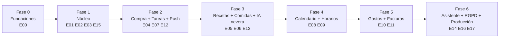

# 00 · Visión y alcance

## Visión

Que una familia (o cualquier grupo que comparte casa) tenga **todo el control del hogar en una sola app privada**, viendo al instante lo que hacen los demás, y con una IA que ayude en el día a día: qué cocinar con lo que hay, qué toca esta semana, cuánto llevamos gastado.

## Decisiones del interrogatorio inicial (2026-11-11)

| # | Tema | Decisión |
|---|---|---|
| 1 | Distribución | **PWA** instalable en Android e iOS, sin tiendas |
| 2 | Acceso | **Solo por invitación**, con la arquitectura preparada para crecer |
| 3 | Idioma y moneda | Solo **español** y **EUR** |
| 4 | Offline | **No.** Requiere conexión; sin ella se muestra un aviso y se bloquea la edición |
| 5 | Desarrollo | Incremental, sin fecha. Lo implementan IAs (Claude Code y OpenCode), de ahí la documentación exhaustiva |
| 6 | Dominio | `hogaria.obaiges.com` (DNS en Netlify) y `api.hogaria.obaiges.com` |
| 7 | Presupuesto | **0 €**, salvo que sea indispensable |
| 8 | Login | Email o nombre de usuario + contraseña, **o** Google |
| 9 | 2FA | No, por ahora (preparado para añadirlo) |
| 10 | Sesión | Indefinida, sin biometría |
| 11 | Invitaciones | Por **enlace**, caducan a los **10 días** |
| 12 | Roles | **Ninguno.** Todo miembro puede hacerlo todo, salvo las reglas de propiedad (ver abajo) |
| 13 | Varios grupos | **Sí**, un usuario puede pertenecer a varios |
| 14 | RGPD | Exportar mis datos y borrar mi cuenta |
| 15–17 | Compra | Varias listas, cantidades, **indispensables**, frecuentes, historial y pasar ingredientes desde comidas o recetas |
| 18 | Inventario | **No.** Solo la foto puntual de la nevera |
| 19–22 | Comidas | Planificador con **5 franjas**, dieta por persona, recetas **a mano**, sin información nutricional |
| 23–25 | Tareas | Recurrentes, **rotación automática**, recordatorios push, sin gamificación por ahora |
| 26–27 | Horarios | Normalmente fijos pero configurables; todos ven los de todos |
| 28–29 | Calendario | Cada uno edita lo suyo y ve lo de los demás. Cumpleaños, citas y eventos recurrentes |
| 30–33 | Gastos de ocio | Visibles para todos, editables solo por su dueño. Sin reparto tipo Splitwise. Categorías, presupuesto mensual, gráficas y **foto de ticket con IA** |
| 34 | Extra | **Gastos fijos y facturas** |
| 35 | Actividad | Feed de actividad del grupo |
| 36 | Push | Solo recordatorios y alertas en su fecha y hora |
| 37 | Conflictos | Gana la última escritura (*last-write-wins*), salvo la lista de la compra, que se resuelve elemento a elemento |
| 38–41 | IA nevera | Varias fotos, ingredientes editables, filtros (tiempo, dificultad, utensilios, dietas), guardar receta, pasar lo que falta a la lista, fotos descartadas |
| 42 | IA extra | **Asistente por chat** |
| 43 | Límites de IA | Límite diario de usos **por grupo** |
| 44–46 | Diseño | Turquesa, dirección "Piscina municipal", modo oscuro, navegación inferior con lo más usado |
| 47 | Alcance | **Todo.** Se construye por fases, sin prisa |
| 48 | Tickets | `HOG-NNN`, puntos (1/2/3/5/8), prioridad P0–P3 y criterios de aceptación |
| 49 | Board | `BOARD.md` con diagrama de flujo. El repo de GitHub se crea más adelante |
| 50 | Tests | Unitarios + e2e en los flujos críticos |

## Reglas de propiedad (lo único que sustituye a los roles)

| Recurso | Quién lo ve | Quién lo edita o borra |
|---|---|---|
| Eventos del calendario | Todo el grupo | **Solo quien lo creó** (`ownerId`) |
| Horario de trabajo | Todos los grupos del usuario | **Solo el propio usuario** |
| Gastos de ocio y presupuestos | Todo el grupo | **Solo su dueño** |
| Perfil de dieta | Todos los grupos del usuario | **Solo el propio usuario** |
| Conversaciones con el asistente | **Solo su autor** | Solo su autor |
| Todo lo demás (listas, recetas, comidas, tareas, facturas, grupo, invitaciones) | Todo el grupo | **Cualquier miembro** |

Al **salir o ser expulsado** de un grupo se borra el contenido personal del usuario en ese grupo (eventos, gastos, presupuestos y conversaciones) y se le quita de rotaciones, comensales y responsables de facturas (ADR-019). Los horarios y la dieta, que no son de un grupo, se conservan.

## Módulos y épicas

| Épica | Módulo | Spec |
|---|---|---|
| E00 | Fundaciones (monorepo, CI, design system, infraestructura) | `docs/01-arquitectura.md`, `docs/06-despliegue.md` |
| E01 | Autenticación y cuentas | `docs/specs/01-auth-cuentas.md` |
| E02 | Grupos e invitaciones | `docs/specs/02-grupos-invitaciones.md` |
| E03 | Tiempo real y actividad | `docs/specs/03-tiempo-real-actividad.md` |
| E04 | Lista de la compra | `docs/specs/04-lista-compra.md` |
| E05 | Recetas | `docs/specs/05-recetas.md` |
| E06 | Planificador de comidas y dietas | `docs/specs/06-comidas-dietas.md` |
| E07 | Tareas del hogar | `docs/specs/07-tareas.md` |
| E08 | Horarios de trabajo | `docs/specs/08-horarios.md` |
| E09 | Calendario y eventos | `docs/specs/09-calendario.md` |
| E10 | Gastos de ocio y presupuestos | `docs/specs/10-gastos.md` |
| E11 | Gastos fijos y facturas | `docs/specs/11-facturas.md` |
| E12 | Notificaciones y recordatorios | `docs/specs/12-notificaciones.md` |
| E13 | IA: núcleo + nevera → recetas | `docs/specs/13-ia-nevera.md` |
| E14 | IA: asistente por chat | `docs/specs/14-ia-asistente.md` |
| E15 | Inicio (dashboard) y navegación | `docs/specs/15-inicio-navegacion.md` |
| E16 | Perfil, ajustes y RGPD | `docs/specs/16-perfil-rgpd.md` |
| E17 | Calidad, seguridad y producción | `docs/specs/17-calidad-produccion.md` |

## Fases de construcción

Al final de la Fase 2 ya hay una app usable en el día a día (compra y tareas compartidas en tiempo real con recordatorios). El despliegue a producción se prepara en la Fase 0 (HOG-02x), así que cada fase se puede publicar.

## Fuera de alcance (por ahora)

- Publicación en App Store o Google Play.
- Modo offline o sincronización diferida.
- 2FA, passkeys y biometría.
- Roles o permisos dentro del grupo.
- Inventario o despensa con caducidades.
- Información nutricional o calorías.
- Importar recetas desde URL. Fotos de recetas.
- Reparto de gastos compartidos (quién debe a quién).
- Gamificación (puntos, rankings).
- Sincronización con Google Calendar.
- Otros idiomas y monedas.
- Notificaciones push de actividad ("Ana añadió leche"): solo se muestran dentro de la app.
