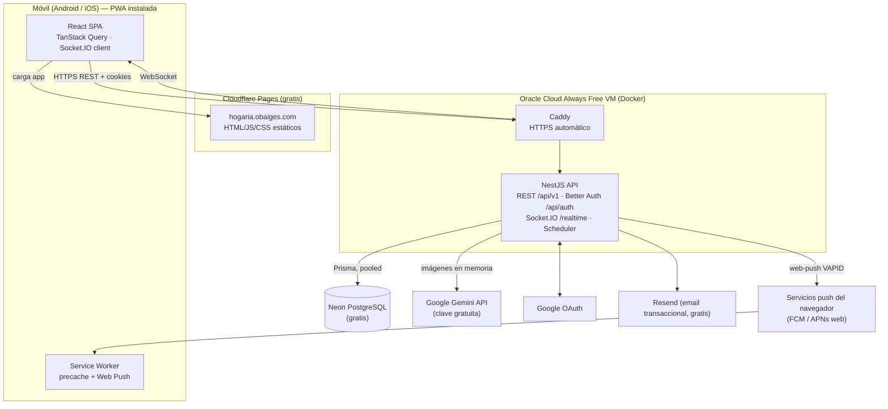
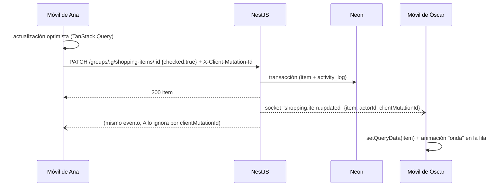

# 01 · Arquitectura

## Vista general



## Stack y versiones objetivo

Fija las versiones exactas en el primer ticket (HOG-001) y anótalas aquí. Usa la última versión estable de cada paquete en el momento de crear el repo.

### Versiones fijadas (HOG-001, 2026-11-11)

Las versiones se fijan exactas en los `package.json` (sin `^`). Cuando un ticket instala una librería de esta tabla, usa esta versión o actualiza la tabla en el mismo commit.

| Paquete | Versión | Nota |
|---|---|---|
| Node | 22 LTS (`.nvmrc`, `engines >=22.12`) | |
| pnpm | 10.5.2 (`packageManager`) | |
| Turborepo | 2.11.10 | |
| TypeScript | **6.0.3** | No 7.x: `typescript-eslint` 8 exige `<6.1` |
| ESLint | **9.39.5** | No 10.x: `eslint-plugin-react` 7.37 no lo soporta |
| typescript-eslint | 8.72.2 | |
| eslint-plugin-import-x | 4.18.1 | + `eslint-import-resolver-typescript` 4.4.5 |
| eslint-plugin-react / react-hooks | 7.37.5 / 7.1.1 | |
| Prettier | 3.10.0 | |
| React | 19.3.1 | HOG-005 |
| Vite | 8.3.8 | HOG-005 |
| Tailwind CSS | 4.3.5 | HOG-005 |
| TanStack Query | 5.107.1 | HOG-005 |
| NestJS | 12.4.x | HOG-003 |
| Prisma | **7.10.1** | La etiqueta `latest` de npm apunta a `8.0.0-rc`; se usa la última estable. Prisma 7 usa `prisma.config.ts` y adaptador de driver |
| Better Auth | 1.7.20 | HOG-050 |
| Socket.IO | 4.8.4 | HOG-150 |
| zod | 4.6.7 | HOG-002 |
| date-fns / @date-fns/tz | 4.4.0 / 1.5.0 | HOG-002 |
| Vitest | 5.1.0 | HOG-010 |
| MSW | 3.0.3 | HOG-010. En v3 la opción es `onUnhandledFrame` (antes `onUnhandledRequest`) |
| Playwright | 1.65.0 | HOG-011 |
| tsup | 9.0.0 | HOG-002 |

### Monorepo
- **pnpm workspaces** + **Turborepo**
- **TypeScript** en modo `strict`, con un `tsconfig` base compartido
- **ESLint** (flat config) + **Prettier**
- Node LTS (fijado en `.nvmrc`)

### Frontend — `apps/web`
| Necesidad | Librería |
|---|---|
| Build | Vite |
| UI | React 19 |
| Router | React Router (data mode) |
| Datos del servidor | TanStack Query |
| Estado de UI local | Zustand (solo estado efímero de UI) |
| Formularios | React Hook Form + `@hookform/resolvers/zod` |
| Estilos | Tailwind CSS v4 con los tokens de `DESIGN.md` como variables CSS |
| Componentes | shadcn/ui (Radix), adaptados al sistema "Piscina municipal" |
| Iconos | lucide-react |
| Fechas | date-fns + `@date-fns/tz` |
| Gráficas | Recharts |
| Markdown | `react-markdown` (render seguro del texto del asistente, sin HTML crudo) |
| Auth | `better-auth/react` client |
| Tiempo real | socket.io-client |
| PWA | vite-plugin-pwa en modo `injectManifest` (service worker propio para el push) |
| Tipografías | `@fontsource/barlow` y `@fontsource/barlow-condensed`, autoalojadas |

### Backend — `apps/api`
| Necesidad | Librería |
|---|---|
| Framework | NestJS (adaptador Express) |
| ORM | Prisma, con el adaptador serverless de Neon o conexión pooled |
| Auth | Better Auth (plugins: `username`, OAuth de Google) montado en `/api/auth/*` |
| Validación | zod (esquemas de `@hogaria/shared`) mediante un `ZodValidationPipe` |
| Tiempo real | `@nestjs/websockets` + `@nestjs/platform-socket.io` |
| Programación de tareas | `@nestjs/schedule` + temporizadores en memoria (ver §Recordatorios) |
| Push | `web-push` (VAPID) |
| IA | `@google/genai` |
| Email | Resend SDK |
| Seguridad | helmet, `@nestjs/throttler`, CORS estricto |
| Logs | `nestjs-pino` |
| Recurrencias | `rrule` |

### Paquete compartido — `packages/shared`
- Esquemas zod de entrada y salida de cada endpoint
- Constantes: pasillos, unidades (`UNITS` de la compra y `RECIPE_UNITS` de las recetas), utensilios (`UTENSILS`), franjas de comida, alérgenos, dietas, categorías, `MAX_GROUP_MEMBERS`
- Nombres y payloads de los eventos en tiempo real
- Códigos de error
- Utilidades puras: dinero (céntimos ↔ "12,34 €"), normalización de nombres de productos, fechas en la zona horaria del grupo

## Estructura del monorepo

```
hogaria/
├─ apps/
│  ├─ web/
│  │  ├─ public/                  # iconos PWA, manifest assets
│  │  ├─ src/
│  │  │  ├─ app/                  # router, providers, layout (AppShell, BottomNav)
│  │  │  ├─ components/ui/        # shadcn adaptados
│  │  │  ├─ components/pool/      # Lane, LaneRope, DepthFigure, MemberDot… (signature)
│  │  │  ├─ features/<modulo>/    # api.ts (hooks Query), components/, pages/, realtime.ts
│  │  │  ├─ lib/                  # apiClient, socket, authClient, dates, money, push
│  │  │  ├─ styles/tokens.css     # tokens de DESIGN.md
│  │  │  └─ sw.ts                 # service worker
│  │  └─ e2e/                     # Playwright
│  └─ api/
│     ├─ prisma/schema.prisma     # ⇐ debe coincidir con docs/02-modelo-datos.md
│     ├─ src/
│     │  ├─ main.ts
│     │  ├─ app.module.ts
│     │  ├─ common/               # guards, decorators, filters, pipes, interceptors
│     │  ├─ prisma/
│     │  ├─ auth/                 # configuración Better Auth + hooks de invitación
│     │  ├─ realtime/             # RealtimeGateway, RealtimePublisher
│     │  ├─ activity/
│     │  ├─ scheduler/            # MaintenanceCron, SchedulerTickRegistry, ReminderScheduler, RetentionJob
│     │  ├─ cli/                  # create-owner, etc.
│     │  └─ modules/              # users, groups, shopping, recipes, meals, diet,
│     │                           # tasks, schedules, calendar, expenses, bills,
│     │                           # notifications, ai, assistant, export
│     └─ test/                    # tests de integración
├─ packages/
│  ├─ shared/
│  └─ config/                     # eslint, tsconfig, prettier compartidos
├─ docs/ · AGENTS.md · CLAUDE.md · BOARD.md · DESIGN.md · PRODUCT.md
├─ docker-compose.yml             # postgres local para desarrollo y tests
└─ deploy/                        # Dockerfile api, Caddyfile, compose prod, scripts backup
```

### Anatomía de un módulo de backend
```
modules/shopping/
├─ shopping.module.ts
├─ shopping-lists.controller.ts   # rutas REST, solo orquestan
├─ shopping-lists.service.ts      # lógica de negocio + transacción + publicar evento + actividad
├─ shopping-items.controller.ts
├─ shopping-items.service.ts
├─ products.service.ts
└─ *.spec.ts                      # tests unitarios junto al código
```
**Patrón de mutación** (aplica en todos los servicios):
1. Validar la entrada (pipe zod) y la autorización (guard de grupo + comprobación de propiedad si aplica).
2. `prisma.$transaction`: escribir los datos y el `ActivityLog`.
3. Tras el commit: `realtime.publish(groupId, event, payload)` y reprogramar recordatorios si aplica (`scheduler.upsertForSource` / `scheduler.cancelForSource`).
4. Devolver el DTO de salida (esquema de `shared`).

**Servicios reutilizables entre módulos:** cada módulo **exporta** sus servicios desde su `*.module.ts` y ofrece métodos de lectura y escritura que reciben un contexto `{ groupId, userId }` (y la transacción cuando aplica). Así el asistente (E14), el Inicio (E15), la exportación (E16) y otros módulos los reutilizan sin escribir consultas Prisma de datos ajenos (spec 14, RN-14-20).

**Hooks de ciclo de vida del grupo** (spec 02): `MemberRemovedHooks` (`onMemberRemoved(tx, { groupId, userId })`, dentro de la transacción de salida, expulsión o borrado de cuenta), `onGroupDeleted(groupId)` y `onGroupTimezoneChanged(groupId)`. Cada módulo con contenido personal o referencias a miembros registra su manejador (ADR-019).

### Anatomía de una feature de frontend
```
features/shopping/
├─ api.ts            # useShoppingLists(), useAddItem()… (TanStack Query, optimistic updates)
├─ realtime.ts       # suscripción a eventos shopping.* → actualiza la caché de Query
├─ pages/ShoppingListsPage.tsx, ShoppingListPage.tsx
└─ components/…
```

## Flujos clave

### Mutación con tiempo real


### Reconexión
Al reconectar el socket, el cliente invalida **todas las queries activas del grupo** (`queryClient.invalidateQueries({ queryKey: ['group', groupId] })`). Así no hace falta reproducir los eventos perdidos.

### Recordatorios (sin polling a la base de datos)
- La tabla `Reminder` guarda las notificaciones futuras con su `fireAt` en UTC.
- **`MaintenanceCron`** (`apps/api/src/scheduler/maintenance.cron.ts`, `@Cron('0 0 */6 * * *', { timeZone: 'Europe/Madrid' })`: 00:00, 06:00, 12:00 y 18:00) es el **único cron** de la API que toca la BBDD. Lo crea E03 junto con el **`SchedulerTickRegistry`** (`scheduler-tick.registry.ts`), y en cada tick ejecuta los handlers registrados por `order`, aislando los errores de cada uno:

  | Handler | Épica | Orden | Qué hace |
  |---|---|---|---|
  | `bills.materialize` | E11 | 10 | Materializa los `BillPayment` de `[primer día del mes actual, hoy + 60 días]` |
  | `retention.purge` | E03 | 20 | Como mucho 1 vez cada 24 h: borra `ActivityLog` > 90 días y `SecurityEvent` > 180 días (`RetentionJob`) |
  | `assistant.purge` | E14 | 30 | Como mucho 1 vez cada 24 h: borra `AiConversation` con `updatedAt` > 180 días |
  | `reminders.reconcile` | E12 | 100 | Reconciliación del horizonte de 7 días, recarga de la ventana de 24 h y limpieza de recordatorios no `PENDING` de más de 30 días |
- `ReminderScheduler` (spec 12):
  - **Horizonte de 7 días** para **todas** las fuentes (puntuales y recurrentes): solo existen filas `PENDING` con `fireAt ∈ (ahora, ahora + 7 días]`. **Ventana en memoria de 24 h:** solo esas tienen `setTimeout`.
  - **Al arrancar:** recuperación (los `PENDING` vencidos hace menos de 1 h se envían; los más antiguos pasan a `MISSED`) y un tick completo.
  - Cuando se crea, edita o borra algo con recordatorio, el servicio llama, **tras el commit**, a `scheduler.upsertForSource(sourceType, sourceId)` o `scheduler.cancelForSource(sourceType, sourceId)`. Al entrar o salir un miembro, E02 llama a `scheduler.rebuildGroup(groupId)` (y antes `cancelForUserInGroup(userId, groupId)` si sale). Al borrar una cuenta, `cancelForUser(userId)` limpia sus temporizadores.
  - Al dispararse, envía Web Push a todas las `PushSubscription` del usuario y marca el recordatorio como `SENT`; si el usuario no tiene suscripciones o fallan todas, queda `FAILED`.
- El detalle está en `docs/specs/12-notificaciones.md`.

### Ventana de actividad de Neon
El plan gratuito de Neon suspende el cómputo tras ~5 min sin consultas y limita las horas de cómputo al mes. Reglas:
- Ningún cron de menos de 6 h toca la base de datos: el único es `MaintenanceCron` (4 ticks al día); los módulos registran sus tareas periódicas en el `SchedulerTickRegistry`, nunca en un cron propio.
- El socket inactivo no hace consultas.
- Los healthchecks (`GET /health`) **no** consultan la base de datos. `GET /health/db` sí, pero solo se usa a mano.

## Entornos

| Entorno | Web | API | BBDD |
|---|---|---|---|
| Local | http://localhost:5173 | http://localhost:3000 | Postgres en Docker (`docker-compose.yml`) |
| Tests | Playwright levanta web + api | — | Postgres en Docker, BBDD `hogaria_test` que se resetea en cada ejecución |
| Producción | https://hogaria.obaiges.com | https://api.hogaria.obaiges.com | Neon, rama `main` |

En local, Vite redirige `/api` y `/realtime` a `localhost:3000` (proxy), para que las cookies funcionen igual que en producción.
