# 02 · Modelo de datos (canónico)

> **Este documento es la fuente de verdad del esquema.** `apps/api/prisma/schema.prisma` debe coincidir con él. Si se cambia el esquema, se actualiza este archivo en el mismo commit.
> Las tablas de Better Auth (`User`, `Session`, `Account`, `Verification`) siguen el formato que genera su CLI (`npx @better-auth/cli generate`), más los campos propios marcados con `// hogaria`.

## Convenciones

- **IDs:** `String @id @default(uuid(7)) @db.Uuid` (UUIDv7, ordenables por tiempo). Better Auth se configura con `advanced.database.generateId` para generar también UUIDv7.
- **Tablas en BBDD** en `snake_case` plural (`@@map`) y **columnas** en `snake_case` (`@map`). En Prisma, los modelos van en PascalCase singular y los campos en camelCase. *Para que el documento se lea mejor, abajo se omiten los `@map` de columnas; el schema real los lleva todos.*
- **Instantes:** `DateTime @db.Timestamptz(3)` en UTC. **Días de calendario:** `DateTime @db.Date`, interpretados en la zona horaria del grupo.
- **Horas locales** (horarios de trabajo): `String` con formato `"HH:mm"` de 24 h.
- **Dinero:** `Int` en céntimos de euro (`amountCents`).
- **Cantidades** de la compra y de recetas: `Decimal @db.Decimal(10,2)`. En la API se serializan como `string`.
- **Borrado lógico** (`deletedAt`) solo donde se indica. Todo lo demás se borra físicamente.
- **Desnormalización intencionada:** las tablas hijas llevan `groupId` aunque se pueda deducir, para que la autorización y los eventos sean de una sola consulta.
- Todas las tablas llevan `createdAt` y `updatedAt` (`@updatedAt`), salvo los logs, que solo tienen `createdAt`.
- **Usuarios borrados (regla real):** solo tienen relación Prisma con `User` (y por tanto `onDelete: Cascade`) `Session`, `Account`, `GroupMember`, `DietProfile`, `WorkSchedule`, `WorkShiftOverride`, `PushSubscription`, `NotificationPreference`, `Reminder` y `AiConversation`. **El resto de campos que guardan un id de usuario no tienen relación Prisma ni FK** en la BBDD: las referencias en contenido compartido (`Group.createdById`, `GroupInvite.createdById`/`usedById`, `ShoppingList.createdById`, `ShoppingItem.addedById`/`checkedById`, `Purchase.purchasedById`, `Recipe.createdById`, `MealPlanEntry.createdById`/`forUserIds`, `Task.createdById`/`currentAssigneeId`/`rotationUserIds`, `TaskCompletion.assigneeId`/`completedById`, `Bill.createdById`/`responsibleUserId`, `BillPayment.paidById`, `ActivityLog.actorId`, `AiUsage.userId`) y el contenido personal (`CalendarEvent.ownerId`, `Expense.ownerId`, `Budget.userId`). Al borrar una cuenta, `UserDeletionService` **anula o borra explícitamente** cada uno de esos campos según una **lista cerrada** (spec 16, RN-16-21), y un **test guardián** recorre el DMMF de Prisma y falla si aparece un campo nuevo que referencie a un usuario (`*UserId`, `*ById`, `ownerId`, `actorId`, `assigneeId`, `userId`) y no está en esa lista. La interfaz muestra "Usuario eliminado" para cualquier referencia `null` o a un usuario que ya no existe. `SecurityEvent.userId` tampoco tiene FK porque debe sobrevivir al borrado.
- **Salir de un grupo** borra el contenido personal del usuario **en ese grupo** (ADR-019) mediante los `MemberRemovedHooks` de la spec 02 (RN-02-22).

## Diagrama entidad-relación (simplificado)

```mermaid
erDiagram
  User ||--o{ GroupMember : "pertenece"
  Group ||--o{ GroupMember : "tiene"
  Group ||--o{ GroupInvite : "emite"
  User ||--o| DietProfile : "tiene"
  User ||--o{ WorkSchedule : "tiene"
  User ||--o{ WorkShiftOverride : "tiene"
  WorkSchedule ||--o{ WorkScheduleSlot : "franjas"
  Group ||--o{ ShoppingList : ""
  ShoppingList ||--o{ ShoppingItem : ""
  Group ||--o{ Product : "catálogo"
  Product ||--o{ Purchase : "historial"
  Group ||--o{ Recipe : ""
  Recipe ||--o{ RecipeIngredient : ""
  Recipe ||--o{ RecipeStep : ""
  Group ||--o{ MealPlanEntry : ""
  Recipe |o--o{ MealPlanEntry : ""
  Group ||--o{ Task : ""
  Task ||--o{ TaskCompletion : ""
  Group ||--o{ CalendarEvent : ""
  Group ||--o{ ExpenseCategory : ""
  ExpenseCategory ||--o{ Expense : ""
  Group ||--o{ Budget : ""
  Group ||--o{ Bill : ""
  Bill ||--o{ BillPayment : ""
  User ||--o{ PushSubscription : ""
  User ||--o{ Reminder : ""
  Group ||--o{ ActivityLog : ""
  Group ||--o{ AiUsage : ""
  User ||--o{ AiConversation : ""
  AiConversation ||--o{ AiMessage : ""
```



## Esquema Prisma

```prisma
generator client {
  provider = "prisma-client-js"
}

datasource db {
  provider  = "postgresql"
  url       = env("DATABASE_URL")   // Neon pooled (-pooler)
  directUrl = env("DIRECT_URL")     // Neon direct, para migraciones
}

// ─────────────────────────────── AUTH (Better Auth) ───────────────────────────────

model User {
  id               String    @id @default(uuid(7)) @db.Uuid
  name             String                       // nombre visible ("Ana")
  email            String    @unique
  emailVerified    Boolean   @default(false)
  image            String?
  username         String?   @unique            // plugin username, en minúsculas
  displayUsername  String?                      // plugin username, como lo escribió
  isPlatformAdmin  Boolean   @default(false)    // hogaria: dueño de la instancia
  blockedAt        DateTime? @db.Timestamptz(3) // hogaria: acceso revocado
  aiNoticeAcceptedAt DateTime? @db.Timestamptz(3) // hogaria: aceptó el aviso de privacidad de IA
  preferInitialsAvatar Boolean @default(false)    // hogaria: mostrar iniciales en lugar de la foto de Google
  createdAt        DateTime  @default(now()) @db.Timestamptz(3)
  updatedAt        DateTime  @updatedAt @db.Timestamptz(3)

  sessions             Session[]
  accounts             Account[]
  memberships          GroupMember[]
  dietProfile          DietProfile?
  workSchedules        WorkSchedule[]
  workShiftOverrides   WorkShiftOverride[]
  pushSubscriptions    PushSubscription[]
  notificationPrefs    NotificationPreference?
  reminders            Reminder[]
  aiConversations      AiConversation[]
  @@map("users")
}

model Session {
  id         String   @id @default(uuid(7)) @db.Uuid
  userId     String   @db.Uuid
  token      String   @unique
  expiresAt  DateTime @db.Timestamptz(3)
  ipAddress  String?
  userAgent  String?
  createdAt  DateTime @default(now()) @db.Timestamptz(3)
  updatedAt  DateTime @updatedAt @db.Timestamptz(3)
  user       User     @relation(fields: [userId], references: [id], onDelete: Cascade)
  @@index([userId])
  @@map("sessions")
}

model Account {
  id                    String    @id @default(uuid(7)) @db.Uuid
  userId                String    @db.Uuid
  accountId             String
  providerId            String    // "credential" | "google"
  accessToken           String?
  refreshToken          String?
  idToken               String?
  accessTokenExpiresAt  DateTime? @db.Timestamptz(3)
  refreshTokenExpiresAt DateTime? @db.Timestamptz(3)
  scope                 String?
  password              String?   // hash (solo providerId = credential)
  createdAt             DateTime  @default(now()) @db.Timestamptz(3)
  updatedAt             DateTime  @updatedAt @db.Timestamptz(3)
  user                  User      @relation(fields: [userId], references: [id], onDelete: Cascade)
  @@index([userId])
  @@map("accounts")
}

model Verification {
  id         String   @id @default(uuid(7)) @db.Uuid
  identifier String
  value      String
  expiresAt  DateTime @db.Timestamptz(3)
  createdAt  DateTime @default(now()) @db.Timestamptz(3)
  updatedAt  DateTime @updatedAt @db.Timestamptz(3)
  @@index([identifier])
  @@map("verifications")
}

enum SecurityEventType {
  LOGIN_SUCCESS
  LOGIN_FAILED
  LOGOUT
  PASSWORD_CHANGED
  PASSWORD_RESET_REQUESTED
  SESSION_REVOKED
  SIGNUP_WITH_INVITE
  SIGNUP_REJECTED_NO_INVITE
  ACCOUNT_DELETED
  DATA_EXPORTED
  ACCOUNT_BLOCKED      // userId = usuario bloqueado; identifier = id del administrador
  ACCOUNT_UNBLOCKED    // userId = usuario desbloqueado; identifier = id del administrador
  EMAIL_VERIFIED       // opcional (P3)
}

model SecurityEvent {
  id         String            @id @default(uuid(7)) @db.Uuid
  userId     String?           @db.Uuid   // sin FK: debe sobrevivir al borrado de la cuenta
  type       SecurityEventType
  identifier String?           // email/username intentado (fallos de login) o id del administrador (ACCOUNT_BLOCKED/UNBLOCKED)
  ipAddress  String?
  userAgent  String?
  createdAt  DateTime          @default(now()) @db.Timestamptz(3)
  @@index([userId, createdAt])
  @@map("security_events")
}
// Retención: 180 días (handler `retention.purge` de `MaintenanceCron`, como mucho una vez cada 24 h; spec 03 RN-03-24).

// ─────────────────────────────── GRUPOS ───────────────────────────────

model Group {
  id          String    @id @default(uuid(7)) @db.Uuid
  name        String                      // "Casa Baiges"
  emoji       String    @default("🏠")
  timezone    String    @default("Europe/Madrid")
  createdById String?   @db.Uuid
  createdAt   DateTime  @default(now()) @db.Timestamptz(3)
  updatedAt   DateTime  @updatedAt @db.Timestamptz(3)

  members          GroupMember[]
  invites          GroupInvite[]
  shoppingLists    ShoppingList[]
  products         Product[]
  recipes          Recipe[]
  mealPlanEntries  MealPlanEntry[]
  tasks            Task[]
  calendarEvents   CalendarEvent[]
  expenseCategories ExpenseCategory[]
  expenses         Expense[]
  budgets          Budget[]
  bills            Bill[]
  activity         ActivityLog[]
  aiUsage          AiUsage[]
  @@map("groups")
}

/// Colores de "calle" (identidad de miembro). Valores = nombres de token en DESIGN.md.
enum LaneColor {
  CORAL
  SUN
  LEAF
  SEA
  VIOLET
  ROSE
  ORANGE
  SLATE
}

model GroupMember {
  id        String    @id @default(uuid(7)) @db.Uuid
  groupId   String    @db.Uuid
  userId    String    @db.Uuid
  laneColor LaneColor             // único dentro del grupo mientras queden colores libres
  joinedAt  DateTime  @default(now()) @db.Timestamptz(3)
  group     Group     @relation(fields: [groupId], references: [id], onDelete: Cascade)
  user      User      @relation(fields: [userId], references: [id], onDelete: Cascade)
  @@unique([groupId, userId])
  @@index([userId])
  @@map("group_members")
}

model GroupInvite {
  id          String    @id @default(uuid(7)) @db.Uuid
  groupId     String    @db.Uuid
  createdById String?   @db.Uuid
  tokenHash   String    @unique             // SHA-256 del token; el token en claro solo va en el enlace
  expiresAt   DateTime  @db.Timestamptz(3)  // createdAt + 10 días
  usedAt      DateTime? @db.Timestamptz(3)
  usedById    String?   @db.Uuid
  revokedAt   DateTime? @db.Timestamptz(3)
  createdAt   DateTime  @default(now()) @db.Timestamptz(3)
  group       Group     @relation(fields: [groupId], references: [id], onDelete: Cascade)
  @@index([groupId])
  @@map("group_invites")
}

// ─────────────────────────────── COMPRA ───────────────────────────────

/// Pasillos del súper. Etiquetas ES en packages/shared (AISLE_LABELS).
enum Aisle {
  FRUITS_VEGETABLES
  MEAT
  FISH
  DAIRY_EGGS
  BAKERY
  PANTRY
  FROZEN
  DRINKS
  SNACKS
  CLEANING
  HYGIENE
  BABY
  PETS
  OTHER
}

model ShoppingList {
  id          String    @id @default(uuid(7)) @db.Uuid
  groupId     String    @db.Uuid
  name        String                    // "Mercadona", "Farmacia"
  emoji       String?
  position    Int                       // orden manual
  createdById String?   @db.Uuid
  archivedAt  DateTime? @db.Timestamptz(3)
  createdAt   DateTime  @default(now()) @db.Timestamptz(3)
  updatedAt   DateTime  @updatedAt @db.Timestamptz(3)
  group       Group     @relation(fields: [groupId], references: [id], onDelete: Cascade)
  items       ShoppingItem[]
  @@index([groupId])
  @@map("shopping_lists")
}

model ShoppingItem {
  id          String    @id @default(uuid(7)) @db.Uuid
  groupId     String    @db.Uuid
  listId      String    @db.Uuid
  productId   String?   @db.Uuid          // enlace al catálogo del grupo
  name        String                      // texto visible
  quantity    Decimal?  @db.Decimal(10, 2)
  unit        String?                     // ver UNITS en shared ("ud", "kg", "g", "l", "ml", "paquete", "lata", "botella", "docena", "bolsa")
  note        String?
  aisle       Aisle     @default(OTHER)
  checked     Boolean   @default(false)
  checkedAt   DateTime? @db.Timestamptz(3)
  checkedById String?   @db.Uuid
  addedById   String?   @db.Uuid
  position    Int
  version     Int       @default(1)       // se incrementa en cada update; resolución por elemento
  createdAt   DateTime  @default(now()) @db.Timestamptz(3)
  updatedAt   DateTime  @updatedAt @db.Timestamptz(3)
  list        ShoppingList @relation(fields: [listId], references: [id], onDelete: Cascade)
  product     Product?     @relation(fields: [productId], references: [id], onDelete: SetNull)
  @@index([listId, checked])
  @@index([groupId])
  @@map("shopping_items")
}

/// Catálogo aprendido del grupo: alimenta autocompletado, frecuentes, indispensables e historial.
model Product {
  id              String    @id @default(uuid(7)) @db.Uuid
  groupId         String    @db.Uuid
  name            String
  normalizedName  String                  // minúsculas, sin acentos, singular simple (shared.normalizeProductName)
  aisle           Aisle     @default(OTHER)
  defaultUnit     String?
  defaultQuantity Decimal?  @db.Decimal(10, 2)
  isEssential     Boolean   @default(false)  // "indispensable"
  purchaseCount   Int       @default(0)
  lastPurchasedAt DateTime? @db.Timestamptz(3)
  createdAt       DateTime  @default(now()) @db.Timestamptz(3)
  updatedAt       DateTime  @updatedAt @db.Timestamptz(3)
  group           Group     @relation(fields: [groupId], references: [id], onDelete: Cascade)
  items           ShoppingItem[]
  purchases       Purchase[]
  @@unique([groupId, normalizedName])
  @@map("products")
}

model Purchase {
  id            String   @id @default(uuid(7)) @db.Uuid
  groupId       String   @db.Uuid
  productId     String   @db.Uuid
  listId        String?  @db.Uuid
  shoppingItemId String? @db.Uuid           // sin relación ni FK (el item se borra al vaciar comprados); permite deshacer la compra al desmarcar (spec 04, RN-04-19)
  quantity      Decimal? @db.Decimal(10, 2)
  unit          String?
  purchasedById String?  @db.Uuid
  purchasedAt   DateTime @default(now()) @db.Timestamptz(3)
  product       Product  @relation(fields: [productId], references: [id], onDelete: Cascade)
  @@index([groupId, purchasedAt])
  @@index([shoppingItemId])
  @@map("purchases")
}

// ─────────────────────────────── RECETAS ───────────────────────────────

enum Difficulty {
  EASY
  MEDIUM
  HARD
}

enum RecipeSource {
  MANUAL
  AI_FRIDGE
  AI_CHAT
}

enum Diet {
  OMNIVORE
  VEGETARIAN
  VEGAN
  PESCATARIAN
}

/// 14 alérgenos de declaración obligatoria en la UE (Reglamento 1169/2011).
enum Allergen {
  GLUTEN
  CRUSTACEANS
  EGGS
  FISH
  PEANUTS
  SOY
  MILK
  TREE_NUTS
  CELERY
  MUSTARD
  SESAME
  SULPHITES
  LUPIN
  MOLLUSCS
}

model Recipe {
  id            String       @id @default(uuid(7)) @db.Uuid
  groupId       String       @db.Uuid
  title         String
  description   String?
  servings      Int          @default(4)
  prepMinutes   Int?
  cookMinutes   Int?
  difficulty    Difficulty?
  tags          String[]                    // libres, en minúsculas ("rápida", "batch cooking")
  utensils      String[]                    // ver UTENSILS en shared ("horno", "airfryer", "thermomix"…)
  allergens     Allergen[]
  suitableDiets Diet[]                      // dietas compatibles; se guarda expandida: VEGAN ⇒ VEGETARIAN ⇒ PESCATARIAN ⇒ OMNIVORE (spec 05, RN-05-05)
  source        RecipeSource @default(MANUAL)
  isFavorite    Boolean      @default(false)
  searchText    String       @default("")   // título + etiquetas + nombres de ingredientes con normalizeProductName; búsqueda con ILIKE sin `unaccent`
  createdById   String?      @db.Uuid
  deletedAt     DateTime?    @db.Timestamptz(3)
  createdAt     DateTime     @default(now()) @db.Timestamptz(3)
  updatedAt     DateTime     @updatedAt @db.Timestamptz(3)
  group         Group        @relation(fields: [groupId], references: [id], onDelete: Cascade)
  ingredients   RecipeIngredient[]
  steps         RecipeStep[]
  mealPlanEntries MealPlanEntry[]
  @@index([groupId])
  @@map("recipes")
}

model RecipeIngredient {
  id        String   @id @default(uuid(7)) @db.Uuid
  recipeId  String   @db.Uuid
  position  Int
  name      String
  quantity  Decimal? @db.Decimal(10, 2)
  unit      String?
  note      String?                      // "picada fina"
  optional  Boolean  @default(false)
  recipe    Recipe   @relation(fields: [recipeId], references: [id], onDelete: Cascade)
  @@index([recipeId])
  @@map("recipe_ingredients")
}

model RecipeStep {
  id       String @id @default(uuid(7)) @db.Uuid
  recipeId String @db.Uuid
  position Int
  text     String
  recipe   Recipe @relation(fields: [recipeId], references: [id], onDelete: Cascade)
  @@index([recipeId])
  @@map("recipe_steps")
}

// ─────────────────────────────── COMIDAS Y DIETA ───────────────────────────────

enum MealSlot {
  BREAKFAST     // Desayuno
  MID_MORNING   // Media mañana
  LUNCH         // Comida
  SNACK         // Merienda
  DINNER        // Cena
}

model MealPlanEntry {
  id          String    @id @default(uuid(7)) @db.Uuid
  groupId     String    @db.Uuid
  date        DateTime  @db.Date
  slot        MealSlot
  recipeId    String?   @db.Uuid
  title       String?                     // texto libre si no hay receta ("Sobras", "Cena fuera")
  servings    Int?
  forUserIds  String[]  @db.Uuid          // vacío = todo el grupo
  note        String?
  createdById String?   @db.Uuid
  createdAt   DateTime  @default(now()) @db.Timestamptz(3)
  updatedAt   DateTime  @updatedAt @db.Timestamptz(3)
  group       Group     @relation(fields: [groupId], references: [id], onDelete: Cascade)
  recipe      Recipe?   @relation(fields: [recipeId], references: [id], onDelete: SetNull)
  @@index([groupId, date])
  @@map("meal_plan_entries")
}
// Regla: recipeId o title es obligatorio (validado en zod). Puede haber varias entradas por franja, como mucho 10 por (groupId, date, slot).
// forUserIds se valida contra los miembros actuales al escribir y se filtra al leer. Si un miembro sale, se le quita de forUserIds
// y se BORRAN las entradas que eran solo para él (spec 06, RN-06-30).

model DietProfile {
  id          String     @id @default(uuid(7)) @db.Uuid
  userId      String     @unique @db.Uuid
  diet        Diet       @default(OMNIVORE)
  allergens   Allergen[]
  otherRestrictions String[]               // "sin lactosa", "bajo en sal"
  dislikes    String[]                     // "coliflor"
  notes       String?
  healthConsentAt DateTime? @db.Timestamptz(3) // consentimiento explícito (art. 9.2.a RGPD) para tratar alergias y restricciones; obligatorio si allergens u otherRestrictions no están vacíos (spec 06)
  updatedAt   DateTime   @updatedAt @db.Timestamptz(3)
  user        User       @relation(fields: [userId], references: [id], onDelete: Cascade)
  @@map("diet_profiles")
}

// ─────────────────────────────── TAREAS ───────────────────────────────

enum RotationMode {
  NONE          // asignación fija (currentAssigneeId) o sin asignar
  ROUND_ROBIN   // rota por rotationUserIds al completar o saltar
}

model Task {
  id                    String       @id @default(uuid(7)) @db.Uuid
  groupId               String       @db.Uuid
  title                 String
  description           String?
  emoji                 String?
  rrule                 String?                    // RFC 5545 RRULE sin DTSTART (la referencia es el nextDueAt vigente); null = puntual
  nextDueAt             DateTime?    @db.Timestamptz(3)  // próxima ocurrencia pendiente; en tareas de todo el día, 00:00 locales del grupo
  allDay                Boolean      @default(true)      // true: vence "ese día"; false: a una hora
  reminderMinutesBefore Int?                       // null = sin recordatorio
  rotationMode          RotationMode @default(NONE)
  rotationUserIds       String[]     @db.Uuid      // orden de la rotación
  currentAssigneeId     String?      @db.Uuid
  archivedAt            DateTime?    @db.Timestamptz(3)  // != null: tarea puntual hecha (o archivada)
  createdById           String?      @db.Uuid
  createdAt             DateTime     @default(now()) @db.Timestamptz(3)
  updatedAt             DateTime     @updatedAt @db.Timestamptz(3)
  group                 Group        @relation(fields: [groupId], references: [id], onDelete: Cascade)
  completions           TaskCompletion[]
  @@index([groupId, nextDueAt])
  @@map("tasks")
}

model TaskCompletion {
  id            String   @id @default(uuid(7)) @db.Uuid
  taskId        String   @db.Uuid
  groupId       String   @db.Uuid
  dueAt         DateTime? @db.Timestamptz(3)  // ocurrencia que se cierra
  assigneeId    String?  @db.Uuid             // a quién le tocaba
  completedById String?  @db.Uuid             // quién la hizo de verdad
  skipped       Boolean  @default(false)      // "saltar esta vez"
  completedAt   DateTime @default(now()) @db.Timestamptz(3)
  task          Task     @relation(fields: [taskId], references: [id], onDelete: Cascade)
  @@index([taskId, completedAt])
  @@map("task_completions")
}

// ─────────────────────────────── HORARIOS DE TRABAJO (personales) ───────────────────────────────

model WorkSchedule {
  id        String    @id @default(uuid(7)) @db.Uuid
  userId    String    @db.Uuid
  name      String                         // "Horario de invierno"
  validFrom DateTime  @db.Date
  validTo   DateTime? @db.Date             // null = indefinido
  createdAt DateTime  @default(now()) @db.Timestamptz(3)
  updatedAt DateTime  @updatedAt @db.Timestamptz(3)
  user      User      @relation(fields: [userId], references: [id], onDelete: Cascade)
  slots     WorkScheduleSlot[]
  @@index([userId])
  @@map("work_schedules")
}
// Regla: los rangos [validFrom, validTo] de un mismo usuario no se solapan.

model WorkScheduleSlot {
  id         String       @id @default(uuid(7)) @db.Uuid
  scheduleId String       @db.Uuid
  weekday    Int                            // 1 = lunes … 7 = domingo (ISO 8601)
  startTime  String                         // "08:00"
  endTime    String                         // "15:00"; si endTime < startTime el turno acaba al día siguiente; endTime = startTime no se permite
  label      String?                        // "Turno mañana", "Teletrabajo"
  schedule   WorkSchedule @relation(fields: [scheduleId], references: [id], onDelete: Cascade)
  @@index([scheduleId])
  @@map("work_schedule_slots")
}

enum ShiftOverrideType {
  DAY_OFF     // Libre
  VACATION    // Vacaciones
  SICK        // Baja
  CUSTOM      // Horario distinto ese día (usa startTime/endTime)
}

model WorkShiftOverride {
  id        String            @id @default(uuid(7)) @db.Uuid
  userId    String            @db.Uuid
  date      DateTime          @db.Date
  type      ShiftOverrideType
  startTime String?
  endTime   String?
  note      String?
  createdAt DateTime          @default(now()) @db.Timestamptz(3)
  updatedAt DateTime          @updatedAt @db.Timestamptz(3)
  user      User              @relation(fields: [userId], references: [id], onDelete: Cascade)
  @@unique([userId, date])
  @@map("work_shift_overrides")
}

// ─────────────────────────────── CALENDARIO ───────────────────────────────

enum EventCategory {
  GENERAL
  BIRTHDAY
  MEDICAL
  SCHOOL
  WORK
  SOCIAL
  TRAVEL
  OTHER
}

model CalendarEvent {
  id                    String        @id @default(uuid(7)) @db.Uuid
  groupId               String        @db.Uuid
  ownerId               String        @db.Uuid     // solo el dueño edita/borra
  title                 String
  description           String?
  location              String?
  category              EventCategory @default(GENERAL)
  allDay                Boolean       @default(false)    // todo el día: startsAt = 00:00 local del primer día y endsAt = 00:00 local del día siguiente al último (exclusivo), en la zona del grupo
  startsAt              DateTime      @db.Timestamptz(3)
  endsAt                DateTime      @db.Timestamptz(3)
  rrule                 String?                    // recurrencia (cumpleaños: FREQ=YEARLY)
  exdates               DateTime[]    @db.Timestamptz(3)  // instantes UTC de inicio de las ocurrencias originales excluidas
  reminderMinutesBefore Int[]                      // p.ej. [1440, 60]
  createdAt             DateTime      @default(now()) @db.Timestamptz(3)
  updatedAt             DateTime      @updatedAt @db.Timestamptz(3)
  group                 Group         @relation(fields: [groupId], references: [id], onDelete: Cascade)
  @@index([groupId, startsAt])
  @@index([ownerId])
  @@map("calendar_events")
}
// Nota: ownerId sin relación Prisma ni FK a User; al borrar la cuenta se borran sus eventos por servicio (spec 16, RN-16-21) y al salir del grupo, por el hook de E09 (ADR-019).

// ─────────────────────────────── GASTOS DE OCIO ───────────────────────────────

model ExpenseCategory {
  id         String    @id @default(uuid(7)) @db.Uuid
  groupId    String    @db.Uuid
  name       String                       // "Restaurantes"
  emoji      String
  position   Int
  archivedAt DateTime? @db.Timestamptz(3)
  createdAt  DateTime  @default(now()) @db.Timestamptz(3)
  updatedAt  DateTime  @updatedAt @db.Timestamptz(3)
  group      Group     @relation(fields: [groupId], references: [id], onDelete: Cascade)
  expenses   Expense[]
  @@unique([groupId, name])
  @@map("expense_categories")
}
// Categorías por defecto al crear grupo: Restaurantes 🍽️, Ocio 🎟️, Viajes ✈️, Ropa 👕, Suscripciones 📺, Deporte 🏃, Regalos 🎁, Caprichos 🍫, Otros 📦

enum ExpenseSource {
  MANUAL
  AI_RECEIPT
}

model Expense {
  id          String        @id @default(uuid(7)) @db.Uuid
  groupId     String        @db.Uuid
  ownerId     String        @db.Uuid       // solo el dueño edita/borra; todos ven
  categoryId  String        @db.Uuid
  amountCents Int                          // > 0
  date        DateTime      @db.Date
  description String
  merchant    String?
  source      ExpenseSource @default(MANUAL)
  createdAt   DateTime      @default(now()) @db.Timestamptz(3)
  updatedAt   DateTime      @updatedAt @db.Timestamptz(3)
  group       Group         @relation(fields: [groupId], references: [id], onDelete: Cascade)
  category    ExpenseCategory @relation(fields: [categoryId], references: [id], onDelete: Restrict)
  @@index([groupId, date])
  @@index([ownerId, date])
  @@map("expenses")
}

model Budget {
  id          String   @id @default(uuid(7)) @db.Uuid
  groupId     String   @db.Uuid
  userId      String   @db.Uuid           // presupuesto personal del usuario en ese grupo
  categoryId  String?  @db.Uuid           // null = presupuesto total mensual. Sin FK: al borrar o archivar la categoría, el servicio borra los presupuestos de esa categoría
  amountCents Int                         // mensual, > 0
  createdAt   DateTime @default(now()) @db.Timestamptz(3)
  updatedAt   DateTime @updatedAt @db.Timestamptz(3)
  group       Group    @relation(fields: [groupId], references: [id], onDelete: Cascade)
  @@unique([groupId, userId, categoryId])
  @@map("budgets")
}
// Ojo: en PostgreSQL los NULL no colisionan en UNIQUE. El servicio garantiza un único budget total (categoryId null) por usuario y grupo.
// Migración: añadir índice único parcial  CREATE UNIQUE INDEX ... ON budgets(group_id, user_id) WHERE category_id IS NULL;

// ─────────────────────────────── GASTOS FIJOS Y FACTURAS ───────────────────────────────

enum BillCategory {
  RENT
  MORTGAGE
  ELECTRICITY
  WATER
  GAS
  INTERNET
  PHONE
  INSURANCE
  SUBSCRIPTION
  COMMUNITY
  TAXES
  SCHOOL
  OTHER
}

enum BillFrequency {
  WEEKLY
  MONTHLY
  BIMONTHLY
  QUARTERLY
  SEMIANNUAL
  YEARLY
}

model Bill {
  id                   String        @id @default(uuid(7)) @db.Uuid
  groupId              String        @db.Uuid
  name                 String                     // "Luz"
  provider             String?                    // "Iberdrola"
  category             BillCategory
  estimatedAmountCents Int?
  frequency            BillFrequency
  dueDay               Int                        // día del mes 1-31 (si no existe → último día); WEEKLY: 1-7 ISO
  startDate            DateTime      @db.Date     // primer periodo
  endDate              DateTime?     @db.Date
  reminderDaysBefore   Int?          @default(3)  // null = sin aviso
  responsibleUserId    String?       @db.Uuid     // quién recibe el aviso; null = todos
  notes                String?
  createdById          String?       @db.Uuid
  archivedAt           DateTime?     @db.Timestamptz(3)
  createdAt            DateTime      @default(now()) @db.Timestamptz(3)
  updatedAt            DateTime      @updatedAt @db.Timestamptz(3)
  group                Group         @relation(fields: [groupId], references: [id], onDelete: Cascade)
  payments             BillPayment[]
  @@index([groupId])
  @@map("bills")
}

enum BillPaymentStatus {
  PENDING
  PAID
}

model BillPayment {
  id            String            @id @default(uuid(7)) @db.Uuid
  billId        String            @db.Uuid
  groupId       String            @db.Uuid
  periodDueDate DateTime          @db.Date     // vencimiento de ese periodo
  amountCents   Int?                           // importe real
  status        BillPaymentStatus @default(PENDING)
  paidAt        DateTime?         @db.Timestamptz(3)
  paidById      String?           @db.Uuid
  note          String?
  createdAt     DateTime          @default(now()) @db.Timestamptz(3)
  updatedAt     DateTime          @updatedAt @db.Timestamptz(3)
  bill          Bill              @relation(fields: [billId], references: [id], onDelete: Cascade)
  @@unique([billId, periodDueDate])
  @@index([groupId, periodDueDate])
  @@map("bill_payments")
}
// Se materializan los periodos con vencimiento en [primer día del mes actual, hoy + 60 días] (handler `bills.materialize` del tick de 6 h
// + al crear, editar o restaurar la factura). Al editar se borran los PENDING desde el mes actual que ya no encajan; los PAID no se tocan.

// ─────────────────────────────── NOTIFICACIONES ───────────────────────────────

model PushSubscription {
  id            String    @id @default(uuid(7)) @db.Uuid
  userId        String    @db.Uuid
  endpoint      String    @unique
  p256dh        String
  auth          String
  userAgent     String?
  failureCount  Int       @default(0)       // se borra al llegar a 3 o con 404/410
  lastSuccessAt DateTime? @db.Timestamptz(3)
  createdAt     DateTime  @default(now()) @db.Timestamptz(3)
  user          User      @relation(fields: [userId], references: [id], onDelete: Cascade)
  @@index([userId])
  @@map("push_subscriptions")
}

model NotificationPreference {
  userId          String  @id @db.Uuid
  tasks           Boolean @default(true)
  events          Boolean @default(true)
  bills           Boolean @default(true)
  quietHoursStart String?                   // "23:00" (hora local del grupo) — los avisos se posponen al final
  quietHoursEnd   String?                   // "08:00"
  user            User    @relation(fields: [userId], references: [id], onDelete: Cascade)
  @@map("notification_preferences")
}

enum ReminderSource {
  TASK
  EVENT
  BILL
}

enum ReminderStatus {
  PENDING
  SENT
  FAILED
  CANCELLED
  MISSED
}

model Reminder {
  id         String         @id @default(uuid(7)) @db.Uuid
  userId     String         @db.Uuid
  groupId    String         @db.Uuid
  sourceType ReminderSource
  sourceId   String         @db.Uuid
  occurrenceAt DateTime     @db.Timestamptz(3)  // ocurrencia a la que se refiere
  fireAt     DateTime       @db.Timestamptz(3)  // cuándo enviar (UTC)
  title      String
  body       String
  url        String                             // deep link de la PWA (rutas en español, docs/08): "/g/<groupId>/tareas?destacar=<taskId>",
                                                // "/g/<groupId>/calendario?fecha=<YYYY-MM-DD>&destacar=<eventId>[&ocurrencia=<ISO>]", "/g/<groupId>/facturas?destacar=<billPaymentId>"
  status     ReminderStatus @default(PENDING)
  sentAt     DateTime?      @db.Timestamptz(3)
  createdAt  DateTime       @default(now()) @db.Timestamptz(3)
  user       User           @relation(fields: [userId], references: [id], onDelete: Cascade)
  @@unique([sourceType, sourceId, userId, fireAt])
  @@index([status, fireAt])
  @@map("reminders")
}

// ─────────────────────────────── ACTIVIDAD ───────────────────────────────

model ActivityLog {
  id         String   @id @default(uuid(7)) @db.Uuid
  groupId    String   @db.Uuid
  actorId    String?  @db.Uuid
  entityType String                         // "shopping_item", "task", … (ver ACTIVITY_ENTITY en shared)
  entityId   String   @db.Uuid
  action     String                         // "created" | "updated" | "deleted" | "checked" | "completed" | "skipped" | "joined" | "left" | "removed" | "revoked" | …
  summary    String                         // texto ES generado en servidor: "añadió Leche a Mercadona"
  metadata   Json?
  createdAt  DateTime @default(now()) @db.Timestamptz(3)
  group      Group    @relation(fields: [groupId], references: [id], onDelete: Cascade)
  @@index([groupId, createdAt])
  @@map("activity_logs")
}
// Retención: 90 días (handler `retention.purge` de `MaintenanceCron`, como mucho una vez cada 24 h; spec 03 RN-03-24).

// ─────────────────────────────── IA ───────────────────────────────

enum AiFeature {
  FRIDGE_DETECT
  FRIDGE_RECIPES
  CHAT
  RECEIPT
}

model AiUsage {
  id           String    @id @default(uuid(7)) @db.Uuid
  groupId      String    @db.Uuid
  userId       String?   @db.Uuid
  feature      AiFeature
  model        String
  inputTokens  Int       @default(0)
  outputTokens Int       @default(0)
  success      Boolean
  errorCode    String?
  createdAt    DateTime  @default(now()) @db.Timestamptz(3)
  group        Group     @relation(fields: [groupId], references: [id], onDelete: Cascade)
  @@index([groupId, feature, createdAt])
  @@map("ai_usage")
}

model AiConversation {
  id        String   @id @default(uuid(7)) @db.Uuid
  groupId   String   @db.Uuid
  userId    String   @db.Uuid                 // privada: solo su autor la ve
  title     String
  createdAt DateTime @default(now()) @db.Timestamptz(3)
  updatedAt DateTime @updatedAt @db.Timestamptz(3)
  user      User     @relation(fields: [userId], references: [id], onDelete: Cascade)
  messages  AiMessage[]
  @@index([userId, groupId, updatedAt])
  @@index([updatedAt])                       // purga de retención
  @@map("ai_conversations")
}
// groupId sin FK a Group: se borran a mano al borrar el grupo (spec 02, RN-02-21) y al salir del grupo (spec 14, RN-14-07).
// Retención: se borran las conversaciones con updatedAt de hace más de 180 días (handler `assistant.purge` de MaintenanceCron, ≤ 1 vez cada 24 h).
// Límites: 100 conversaciones por usuario y grupo, 200 mensajes USER + ASSISTANT por conversación (spec 14).

enum AiMessageRole {
  USER
  ASSISTANT
  TOOL
}

model AiMessage {
  id             String        @id @default(uuid(7)) @db.Uuid
  conversationId String        @db.Uuid
  role           AiMessageRole
  content        String        @db.Text
  toolName       String?
  toolPayload    Json?                          // argumentos/resultado de la herramienta
  pendingAction  Json?                          // acción de escritura propuesta que requiere confirmación
  createdAt      DateTime      @default(now()) @db.Timestamptz(3)
  conversation   AiConversation @relation(fields: [conversationId], references: [id], onDelete: Cascade)
  @@index([conversationId, createdAt])
  @@map("ai_messages")
}
// Uso por rol (spec 14 §4):
//   USER      → content = texto del usuario.
//   ASSISTANT → content = respuesta; si es una propuesta, content = summary y pendingAction = objeto de spec 14 §5.2
//               (estados PENDING | EXECUTING | CONFIRMED | REJECTED | FAILED | EXPIRED; caduca a las 24 h).
//   TOOL      → content = "", toolName y toolPayload = { args, result } (resultado recortado a 8 KB). Nunca sale de la API.
```

## Datos semilla al crear un grupo

- Lista de la compra "Compra" (🛒, posición 0).
- Las 9 `ExpenseCategory` por defecto.
- `GroupMember` del creador con `laneColor = CORAL`.

## Asignación de `laneColor`

Orden: `CORAL, SEA, SUN, LEAF, VIOLET, ROSE, ORANGE, SLATE`. Cada miembro nuevo recibe el primer color libre del grupo. Si se acaban (más de 8 miembros), se reutilizan en el mismo orden. Cada usuario puede cambiar el suyo en Ajustes del grupo, siempre que no lo tenga otro miembro.

## Límite de miembros

`MAX_GROUP_MEMBERS = 20` (`packages/shared/src/constants/groups.ts`). Aceptar o crear una invitación en un grupo lleno → `409 CONFLICT` (spec 02, RN-02-06).

## Estimación de tamaño (plan gratuito de Neon)

Un hogar de 4 personas con un uso intenso genera unos 15–25 MB al año (la actividad se purga a los 90 días y no se guardan imágenes). Hay margen de sobra para varios hogares durante años.
