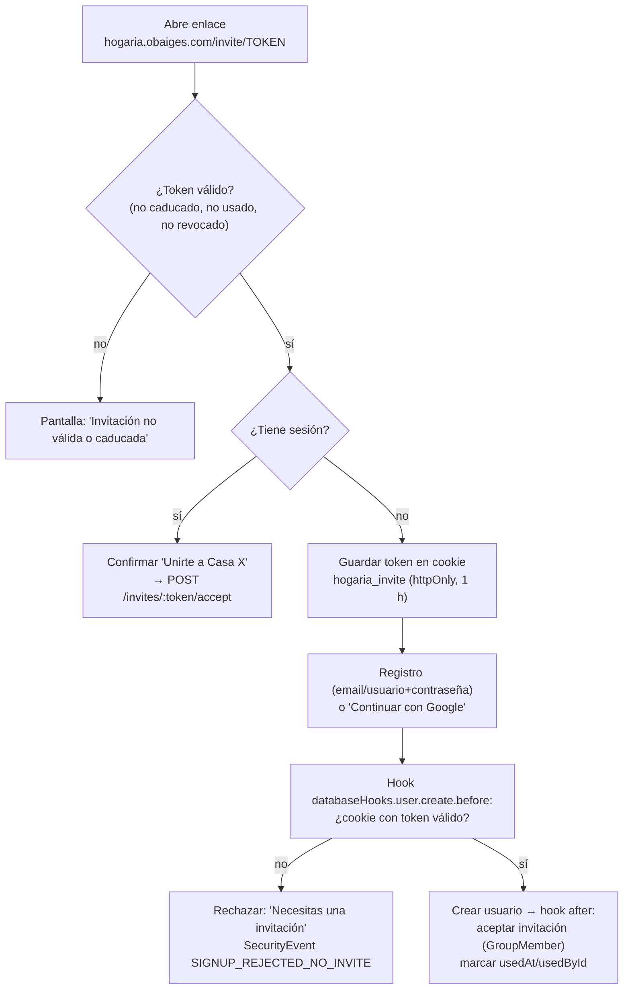

# 03 · Seguridad, autenticación y privacidad

## Objetivos

1. Solo entra quien ha sido invitado.
2. Nadie ve ni modifica datos de un grupo al que no pertenece.
3. Las credenciales nunca se exponen: hashes fuertes, cookies `httpOnly` y secretos fuera del código.
4. Cumplir el RGPD en lo básico: minimización, exportación y borrado.

## Autenticación (Better Auth)

| Aspecto | Decisión |
|---|---|
| Métodos | Email + contraseña · nombre de usuario + contraseña (plugin `username`) · Google OAuth |
| Hash de contraseñas | El que trae Better Auth por defecto (scrypt) |
| Política de contraseña | Mínimo **10** caracteres y máximo 128. Se rechazan las 10 000 contraseñas más comunes (lista local en `packages/shared`, sin llamadas externas) y las que contienen el email o el username |
| Verificación de email | **Obligatoria** para cuentas con contraseña (enlace por email con Resend). Las cuentas de Google ya llegan verificadas |
| Recuperar contraseña | Enlace por email, válido 30 min y de un solo uso. La respuesta es siempre "Si existe una cuenta, te hemos enviado un email" (no se revela si existe) |
| Sesión | Cookie `httpOnly`, `Secure`, `SameSite=Lax`, `Domain=.hogaria.obaiges.com`. `expiresIn` = 365 días con `updateAge` = 1 día (renovación deslizante), así que **mientras se use, la sesión es indefinida** |
| Gestión de sesiones | En Perfil → Seguridad: lista de dispositivos, cerrar una sesión y "Cerrar sesión en todos los demás", con los endpoints de Better Auth `GET /api/auth/list-sessions`, `POST /api/auth/revoke-session` y `POST /api/auth/revoke-other-sessions` |
| Cambio de contraseña | Pide la actual y revoca las demás sesiones |
| Bloqueo por fuerza bruta | Rate limit en `/api/auth/sign-in/*` contado **solo con intentos fallidos**: 5 por minuto por (IP + identificador normalizado) y 20 por hora por identificador. Un login correcto pone a cero el contador de (IP + identificador). Al superarlo, `429 RATE_LIMITED` con `Retry-After`. Los contadores viven **en memoria** (`LoginRateLimiter`; una sola instancia de API) y se reinician al reiniciar la API (spec 01, RN-01-26) |
| Otros límites de auth | En memoria y por IP salvo indicación: `/sign-up/email` 5 por hora; `/request-password-reset` 3 por hora por email y 10 por hora por IP; `/send-verification-email` 1 cada 60 s y 5 por hora por email; resto de `/api/auth/*` 60 por minuto (spec 01, RN-01-27) |
| Vincular cuentas | Un usuario con contraseña puede vincular Google con el mismo email verificado (`accountLinking` habilitado solo para `google` y con email verificado) |
| Preparado para el futuro | Plugins `twoFactor` y `passkey` de Better Auth (no activos). Activarlos es un ticket aparte |

## Registro solo por invitación

- **Token:** 32 bytes aleatorios (`crypto.randomBytes`) en base64url. En la BBDD **solo se guarda el SHA-256**.
- **Caducidad:** 10 días. **Un solo uso.** Se puede revocar.
- **Quién puede invitar:** cualquier miembro del grupo (no hay roles). La variable `SIGNUP_REQUIRES_INVITE=true` existe para el día en que se abra el registro.
- **Login con Google sin cuenta previa y sin invitación:** se rechaza con el mismo mensaje. Login con Google con cuenta existente: siempre se permite.
- **Usuario ya registrado** que abre una invitación: solo se une al grupo, no se registra.
- **Primer usuario (administrador de la plataforma):** se crea por CLI (`pnpm --filter api cli create-owner`), sin invitación, con `isPlatformAdmin = true`. Desde Ajustes puede ver los usuarios de la instancia y **bloquearlos** (`blockedAt`). Un usuario bloqueado no puede iniciar sesión y sus sesiones se revocan.

## Autorización

### Capas
1. **`AuthGuard` global:** toda ruta exige sesión salvo las marcadas con `@Public()` (health, la validación pública de invitaciones y `/api/auth/*`).
2. **`GroupMemberGuard`:** todas las rutas `/api/v1/groups/:groupId/**` comprueban que exista un `GroupMember(groupId, user.id)`. Si no existe, devuelven **404** (no 403), para no revelar que el grupo existe. El resultado se cachea en memoria 60 s por (userId, groupId) y se invalida al salir o expulsar.
3. **Propiedad:** para `CalendarEvent`, `Expense`, `Budget`, `WorkSchedule*`, `WorkShiftOverride`, `DietProfile` y `AiConversation`, el servicio comprueba `ownerId`/`userId === user.id` antes de modificar. Si falla, `403 FORBIDDEN_NOT_OWNER`.
4. **Ámbito en las consultas:** toda consulta Prisma de datos de grupo incluye `where: { groupId }`. Se buscan por `id` **y** `groupId` a la vez (`findFirst({ where: { id, groupId } })`), nunca solo por `id`.
5. **Socket.IO:** el handshake autentica con la cookie de sesión. `join` a la sala `group:<id>` solo tras comprobar la membresía. Al salir o ser expulsado se fuerza `socket.leave`.

### Tests obligatorios de autorización
Cada módulo tiene un test de integración que comprueba:
- Que un usuario de otro grupo recibe 404 en GET, PATCH y DELETE.
- Que un miembro no dueño recibe 403 al editar recursos con propiedad.
- Que sin sesión se recibe 401.

## Protecciones web

| Riesgo | Medida |
|---|---|
| CSRF | Cookies `SameSite=Lax` + comprobación de `Origin` contra `trustedOrigins` en Better Auth y en un middleware global para métodos no GET |
| XSS | React escapa por defecto. Prohibido `dangerouslySetInnerHTML` (regla de ESLint); el texto del asistente se pinta con `react-markdown` sin HTML crudo. CSP estricta en `_headers` de Cloudflare Pages (spec 17, RN-17-01): `default-src 'self'; script-src 'self'; style-src 'self' 'unsafe-inline'; img-src 'self' data: blob: https://lh3.googleusercontent.com; font-src 'self'; connect-src 'self' https://api.hogaria.obaiges.com wss://api.hogaria.obaiges.com; worker-src 'self'; manifest-src 'self'; object-src 'none'; base-uri 'self'; form-action 'self' https://api.hogaria.obaiges.com; frame-ancestors 'none'; upgrade-insecure-requests` (`form-action` incluye la API porque el inicio de sesión con Google navega a `/api/auth/*`) |
| Cabeceras | helmet en la API. En la web: `Strict-Transport-Security: max-age=31536000; includeSubDomains`, `X-Content-Type-Options: nosniff`, `Referrer-Policy: strict-origin-when-cross-origin`, `Permissions-Policy: camera=(self), microphone=(), geolocation=(), payment=(), usb=()`, `X-Frame-Options: DENY` y `Cross-Origin-Opener-Policy: same-origin` |
| CORS | Solo `https://hogaria.obaiges.com` (y `http://localhost:5173` en desarrollo), con `credentials: true` |
| Rate limiting | `@nestjs/throttler`: 120 req/min por usuario en general; endpoints de IA según `docs/05-ia.md`; crear invitaciones 20 al día por usuario y como mucho 20 invitaciones activas por grupo (`409 CONFLICT`); `GET /invites/:token` (público) 30 por minuto por IP; `GET /me/export` 3 por hora por usuario; `GET /health/db` 6 por minuto por IP. Se cuenta por usuario autenticado o, sin sesión, por IP; la API confía en `X-Forwarded-For` solo desde loopback y redes privadas (`trust proxy: 'loopback, uniquelocal'`, Caddy en la red de Docker). Límites específicos con `@RateLimit(limit, ttlMs)` (HOG-014) |
| Cuerpo de la petición | JSON de hasta 1 MB, solo bajo `/api/v1` (Better Auth lee su propio cuerpo en `/api/auth/*`). JSON mal formado o demasiado grande → `422 VALIDATION_ERROR` |
| Origin (CSRF) | Middleware global: `POST/PATCH/PUT/DELETE` con cabecera `Origin` fuera de la lista (`APP_URL` y, en desarrollo, `http://localhost:5173`) → `403 FORBIDDEN_ORIGIN`. Sin cabecera `Origin` no se bloquea (lo cubre `SameSite=Lax`) |
| Subida de imágenes | Solo `image/jpeg`, `image/png` e `image/webp`, como mucho 5 MB por imagen y 4 imágenes por petición. Se valida la firma (magic bytes), no solo el MIME. Nunca se escriben a disco |
| Inyección SQL | Solo Prisma. `$queryRaw` únicamente con *tagged templates* |
| Enumeración | Mensajes genéricos en login y recuperación. 404 para grupos ajenos |
| Dependencias | Dependabot o Renovate en GitHub y `pnpm audit` en CI |
| Secretos | `.env` fuera de git. En producción, en el `.env` de la VM con permisos `600` |

## Privacidad (RGPD)

- **Datos personales:** nombre, email, username, foto de Google (URL), horarios, dieta y alergias (**datos de salud: categoría especial**, solo se comparten con los grupos del usuario y la IA los usa solo para generar recetas o en el chat de ese grupo).
- **Consentimiento explícito para datos de salud** (art. 9.2.a RGPD): la primera vez que el usuario guarda alérgenos u otras restricciones en su perfil de dieta debe marcar "Acepto que Hogaria trate mis alergias y restricciones para proponer comidas". Se guarda en `DietProfile.healthConsentAt`; sin él, la API responde `422 HEALTH_CONSENT_REQUIRED` (spec 06). Retirarlo vacía alérgenos y restricciones.
- **Imágenes:** no se guardan. Se envían a Gemini y se descartan.
- **Aviso de IA:** el plan gratuito de Gemini permite a Google usar los datos para mejorar sus productos. La primera vez que un usuario usa la IA ve un aviso que debe aceptar. La aceptación se guarda en `User.aiNoticeAcceptedAt`, y los endpoints de IA devuelven `403 AI_NOTICE_REQUIRED` mientras sea `null`. No se envían a Gemini nombres completos ni emails: en los prompts los miembros aparecen por su nombre visible.
- **Exportar mis datos:** JSON descargable con todo lo del usuario (ver `docs/specs/16-perfil-rgpd.md`).
- **Borrar mi cuenta:** borrado inmediato y permanente tras confirmar escribiendo "BORRAR". El contenido compartido queda como "Usuario eliminado".
- **Páginas legales:** Privacidad y Términos estáticos en la PWA (`/legal/privacidad`, `/legal/terminos`). Hay que redactarlos (ticket en E16).
- **Logs:** no se registran contraseñas, tokens, cookies, cuerpos ni *query strings*. Se registra la **plantilla de ruta** (`/api/v1/invites/:token`), nunca la URL real, porque las invitaciones llevan el token en la ruta. Redacción obligatoria de `nestjs-pino` (spec 17, RN-17-17): `req.headers.cookie`, `req.headers.authorization`, `res.headers["set-cookie"]`, `*.password`, `*.token`, `*.newPassword`, `*.currentPassword`.
- **Retenciones** (las publica la política de privacidad):

| Dato | Retención | Mecanismo |
|---|---|---|
| Logs del servidor | ≤ 14 días | journald (`MaxRetentionSec=14day`, ADR-017) |
| `SecurityEvent` (con IP) | 180 días | Handler `retention.purge` de `MaintenanceCron` (spec 03, RN-03-24) |
| `ActivityLog` | 90 días | Mismo handler |
| Conversaciones del asistente | 180 días sin uso | Handler `assistant.purge` de `MaintenanceCron` (spec 14) |
| Recordatorios enviados o cancelados | 30 días | Tick del `ReminderScheduler` (spec 12) |
| Copias de seguridad | ≤ 8 semanas (8 copias semanales) | `deploy/backup.sh` (spec 17) |

- **Tras restaurar una copia** (puede contener cuentas borradas después de su fecha): el administrador vuelve a borrar esas cuentas con `pnpm --filter api cli delete-user --id <uuid>`, identificándolas por los `SecurityEvent ACCOUNT_DELETED` de la base anterior a la restauración (si sigue accesible) o por los eventos `account.deleted` del log (spec 16, RN-16-26; spec 17, RN-17-25).
- **Ubicación:** la BBDD (Neon, Frankfurt), la VM y el bucket de copias se crean en regiones de la **UE**.

## Copias de seguridad

- Neon (gratis): restauración a un momento anterior dentro de una ventana corta. **No basta.**
- Cron semanal en la VM: `pg_dump` de Neon → comprimido y cifrado con `age` → subido a Oracle Object Storage (Always Free, 20 GB). Se conservan las 8 últimas copias. Script en `deploy/backup.sh` (ticket en E17).
- La restauración está documentada y probada una vez (ticket en E17).
