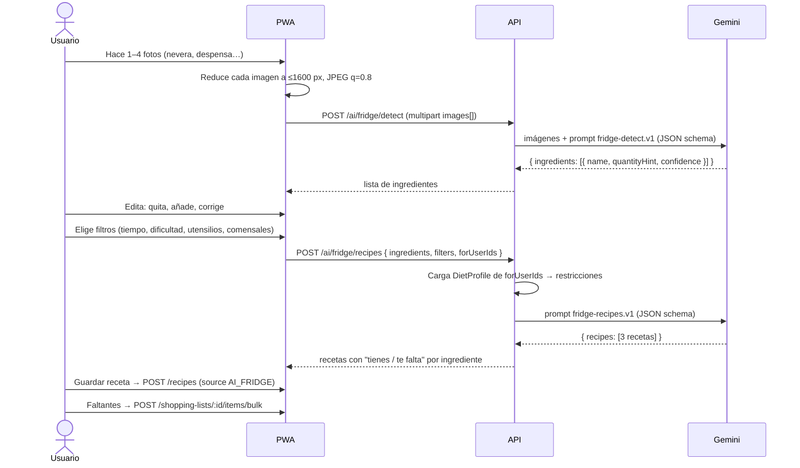

# 05 · Inteligencia artificial (Gemini)

## Principios

1. **La clave vive solo en el backend** (`GEMINI_API_KEY`). El navegador nunca llama a Gemini.
2. **La IA propone y la persona decide:** todo resultado se revisa y se puede editar antes de guardarse.
3. **Las imágenes no se guardan:** las reduce **el cliente** (≤ 1600 px, JPEG 0,8); el servidor no reescala, solo valida (tipo por magic bytes y tamaño), las mantiene en memoria y las envía a Gemini en línea (base64). Después se descartan.
4. **Salida estructurada:** siempre `responseMimeType: "application/json"` + `responseSchema`, y después se valida con zod. Si la validación falla, se reintenta una vez y luego se devuelve `AI_UNAVAILABLE`.
5. **Modelo configurable:** `GEMINI_MODEL` (por defecto el modelo *Flash* más reciente del plan gratuito, comprobado al implementar HOG-650). No se fija el nombre del modelo en el código. **La API no arranca si `GEMINI_MODEL` está vacío** (spec 13, RN-13-01).

## Módulo `ai` del backend

```
modules/ai/
├─ gemini.client.ts        # wrapper de @google/genai: generateStructured(), streamChat(), timeouts (30 s), reintento 1×
├─ ai-quota.service.ts     # límites diarios por grupo y feature
├─ ai-notice.guard.ts      # exige User.aiNoticeAcceptedAt
├─ image.util.ts           # validación de magic bytes y tamaño
├─ fridge.service.ts       # detect + recipes
├─ receipt.service.ts      # ticket → gasto
└─ prompts/                # plantillas versionadas (fridge-detect.v1.ts, …)
```

## Límites diarios por grupo

Se cuentan las filas de `AiUsage` con `success = true` del día natural en la zona horaria del grupo. Los valores son configurables por variables de entorno:

| Feature | Variable | Por defecto |
|---|---|---|
| Detectar ingredientes (nevera) | `AI_LIMIT_FRIDGE_DETECT` | 10 |
| Generar recetas (nevera) | `AI_LIMIT_FRIDGE_RECIPES` | 15 |
| Mensajes del asistente | `AI_LIMIT_CHAT` | 60 |
| Tickets → gasto | `AI_LIMIT_RECEIPT` | 20 |

- `GET /groups/:g/ai/quota` → `{ feature, used, limit, resetsAt }[]`, **siempre las 4 features**, en el orden de `AI_FEATURES` (`FRIDGE_DETECT`, `FRIDGE_RECIPES`, `CHAT`, `RECEIPT`).
- Al superarse: `429 AI_LIMIT_REACHED` con los miembros de extensión `feature`, `limit` y `resetsAt` en el problem+json. La interfaz muestra "Habéis usado los 10 análisis de hoy. Se renuevan a las 00:00".
- Throttle adicional por usuario: 6 peticiones de IA por minuto.
- Si Gemini devuelve 429 (cuota gratuita de Google agotada), se responde `AI_UNAVAILABLE` con el mensaje "La IA está saturada, prueba en unos minutos". **No** cuenta para el límite del grupo.

## Flujo 1: nevera → recetas



### Esquema de salida de `detect`
```ts
z.object({
  ingredients: z.array(z.object({
    name: z.string().min(1).max(60),          // "pimiento rojo"
    quantityHint: z.string().max(40).nullable(), // "2 unidades", "medio paquete"
    confidence: z.enum(['high', 'medium', 'low']),
  })).max(60),
  notes: z.string().max(300).nullable(),        // "La foto está oscura; puede faltar algo"
})
```

### Entrada y salida de `recipes`
```ts
// entrada
z.object({
  ingredients: z.array(z.string().min(1).max(60)).min(1).max(60),
  filters: z.object({
    maxTotalMinutes: z.number().int().min(5).max(240).nullable(),
    difficulty: z.enum(['EASY','MEDIUM','HARD']).nullable(),
    utensils: z.array(z.string()).max(10),   // disponibles
    mealSlot: z.enum(['BREAKFAST','MID_MORNING','LUNCH','SNACK','DINNER']).nullable(),
    servings: z.number().int().min(1).max(12),
  }),
  forUserIds: z.array(z.string().uuid()),     // vacío = todo el grupo
  allowExtraIngredients: z.boolean(),         // permitir básicos que falten
})
// salida (3 recetas)
z.object({ recipes: z.array(z.object({
  title: z.string(), description: z.string(),
  servings: z.number().int(), prepMinutes: z.number().int(), cookMinutes: z.number().int(),
  difficulty: z.enum(['EASY','MEDIUM','HARD']),
  utensils: z.array(z.string()),
  allergens: z.array(AllergenEnum), suitableDiets: z.array(DietEnum),
  ingredients: z.array(z.object({ name: z.string(), quantity: z.string().nullable(), unit: z.string().nullable(), available: z.boolean() })),
  steps: z.array(z.string()).min(1),
  warnings: z.array(z.string()),             // "Contiene huevo: Lucía es alérgica"
})).max(3),                                  // hasta 3: menos si las restricciones no lo permiten
  notes: z.string().nullable(),              // explicación si devuelve menos de 3 o ninguna
})
```
El DTO de la API (`fridgeRecipesDto`, spec 13) añade a cada receta `allergenConflicts` (comprobación del servidor contra los perfiles) y, a la respuesta, `constraints` (eco de las restricciones aplicadas: dieta más restrictiva, alérgenos excluidos, tiempo y utensilios).

### Reglas del prompt `fridge-recipes.v1`
- Responder en **español de España**, con unidades métricas.
- **No incluir nunca** alérgenos declarados por los comensales. Si es imposible, devolver menos recetas y avisarlo en `warnings`.
- Respetar la dieta más restrictiva de los comensales (vegana > vegetariana > pescetariana > omnívora).
- Priorizar los ingredientes disponibles. Se pueden asumir básicos de despensa (sal, aceite, agua, pimienta) como disponibles.
- Respetar el tiempo total y los utensilios disponibles.
- Si es imposible cumplir todo, devolver menos recetas (o ninguna) y explicarlo en `notes`.
- El servidor **vuelve a comprobar** los alérgenos de la salida contra los perfiles y añade `warnings` si la IA se equivoca (defensa en profundidad).

## Flujo 2: ticket → gasto

- `POST /groups/:g/ai/receipt` multipart con **un solo** campo `image` (una imagen). Prompt `receipt.v1`.
- Salida: `{ merchant, date (YYYY-MM-DD|null), totalCents (int|null), suggestedCategoryName (string|null), description }`. `suggestedCategoryName` debe coincidir **exactamente** con el nombre de una categoría **no archivada** del grupo (se le pasa la lista en el prompt); si no coincide, el servidor lo devuelve como `null`.
- La web abre el formulario de gasto **rellenado** para que el usuario lo confirme o lo corrija. No se guarda nada sin confirmación.

## Flujo 3: asistente por chat

- **Conversaciones privadas** de cada usuario dentro de un grupo. El detalle completo está en `docs/specs/14-ia-asistente.md`.
- Streaming con SSE (`text/event-stream`) desde `POST .../messages` (ver "Protocolo SSE" abajo).
- **Function calling** con herramientas que el servidor ejecuta **con los permisos del usuario**:

| Herramienta | Tipo | Descripción |
|---|---|---|
| `get_shopping_lists` | lectura | Listas e items pendientes |
| `get_meal_plan` | lectura | Comidas de un rango de fechas |
| `get_recipes` | lectura | Buscar recetas por texto o etiquetas |
| `get_tasks` | lectura | Tareas pendientes, asignadas y vencidas |
| `get_calendar` | lectura | Eventos de un rango |
| `get_work_schedules` | lectura | Horarios de los miembros en un rango |
| `get_expenses_summary` | lectura | Totales por categoría, usuario y mes |
| `get_bills` | lectura | Facturas próximas y pendientes |
| `get_diet_profiles` | lectura | Dietas y alergias de los miembros |
| `add_shopping_items` | **escritura** | Propone añadir items a una lista |
| `create_meal_plan_entries` | **escritura** | Propone planificar comidas |
| `create_recipe` | **escritura** | Propone guardar una receta |
| `create_task` | **escritura** | Propone crear una tarea |
| `create_calendar_event` | **escritura** | Propone un evento (dueño: el propio usuario) |

- **Las herramientas de escritura nunca se ejecutan directamente:** el servidor guarda `AiMessage.pendingAction` y la interfaz muestra una tarjeta "¿Añadir 5 productos a Mercadona? [Confirmar] [Descartar]". Al confirmar se llama al servicio normal del módulo (con su actividad y tiempo real).
- Contexto que se envía en cada turno: fecha y hora actuales en la zona del grupo, nombre del grupo, miembros (nombre visible y color), el usuario actual y los últimos 20 mensajes de la conversación.
- Instrucción de sistema: asistente doméstico, responde en español, conciso, nunca inventa datos (si no los tiene, usa herramientas) y no da consejo médico.
- Cada mensaje del usuario cuenta como 1 uso de `CHAT` (las llamadas internas a herramientas no cuentan).

### Protocolo SSE de `POST .../messages`

- Respuesta `200` con `Content-Type: text/event-stream; charset=utf-8`, `Cache-Control: no-cache, no-transform` y `X-Accel-Buffering: no`, sin compresión. Caddy no debe bufferizar (`flush_interval -1`, ver `docs/06-despliegue.md`). Cada 15 s sin datos se envía el comentario `: ping`.
- Formato `event: <nombre>\ndata: <JSON>\n\n`. La web lo lee con `fetch` + `ReadableStream` (`apps/web/src/lib/sse.ts`), no con `EventSource`.
- Los errores **antes** de abrir el stream (401, 403, 404, 409, 422, 429) se devuelven como problem+json normal.

| Evento | `data` | Cuándo |
|---|---|---|
| `user_message` | `AiMessageDto` | Primero: el mensaje del usuario ya guardado |
| `tool` | `{ name, label }` | Al empezar a ejecutar una herramienta de lectura ("Consultando la lista de la compra…") |
| `delta` | `{ text }` | Fragmento de texto de la respuesta |
| `action` | `AiMessageDto` con `pendingAction` | Cada propuesta de escritura |
| `done` | `{ message: AiMessageDto \| null, quota: AiQuotaDto, title }` | Fin del turno |
| `error` | `{ code, detail, retryable }` | Fallo durante el stream; después se cierra |

Orden garantizado: `user_message` → (`tool` | `delta` | `action`)* → `done` | `error`.

### `pendingAction` (propuestas de escritura)

- Estados (`AI_ACTION_STATUSES`): `PENDING` → `EXECUTING` → `CONFIRMED` | `FAILED`; `PENDING` → `REJECTED`; `PENDING` → `EXPIRED` (caduca a las **24 h**). Si el módulo responde 5xx al confirmar, vuelve a `PENDING`.
- Confirmar o rechazar una propuesta ya resuelta, en ejecución o caducada → `409 CONFLICT`. Confirmar o rechazar no consume cuota.
- El `summary` y la `preview` los genera el servidor con plantillas fijas, nunca a partir del texto del modelo.

### Límites del asistente

| Límite | Valor |
|---|---|
| Conversaciones por usuario y grupo | 100 (la 101.ª borra la de `updatedAt` más antigua) |
| Mensajes `USER` + `ASSISTANT` por conversación | 200 |
| Longitud de un mensaje del usuario | 2000 caracteres |
| Rondas de herramientas por turno | 5 |
| Propuestas de escritura por turno | 3 |
| Tiempo total por turno | 60 s (cada llamada a Gemini, 30 s) |
| Turnos simultáneos por conversación | 1 (`409 CONFLICT`) |
| Respuesta de una herramienta de lectura | 8 KB de JSON |
| Retención | 180 días sin actividad (`updatedAt`); purga en el handler `assistant.purge` de `MaintenanceCron` |
| Al salir del grupo | Se borran las conversaciones del usuario en ese grupo (ADR-019) |

## Prompts

- Guardados en `apps/api/src/modules/ai/prompts/*.ts`, exportados como funciones puras con su número de versión.
- Cada cambio de prompt sube la versión y conserva la anterior hasta validarlo.
- Tests: snapshot del prompt generado + tests con respuestas simuladas de Gemini (no se llama a Gemini en CI).
